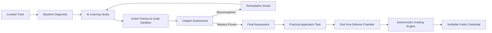

<div align="center">

  

  # CERTIFY

  **AI-First Interactive Engineering Qualification & Credentialing Platform**

  *Credentials earned through demonstrated, defensible understanding — never passive video completion.*

  <br />

  [](https://www.typescriptlang.org/)
  [](https://react.dev/)
  [](https://vitejs.dev/)
  [](https://nodejs.org/)
  [](https://expressjs.com/)
  [](https://www.prisma.io/)
  [](https://github.com/oframe/ogl)
  [](https://vitest.dev/)
  [](LICENSE)

</div>

---

## 📖 Table of Contents

- [Overview & The Core Thesis](#-overview--the-core-thesis)
- [The Pedagogical & Certification Protocol](#-the-pedagogical--certification-protocol)
- [Key Innovations & Features](#-key-innovations--features)
- [Visual Interface Tour](#-visual-interface-tour)
- [System Architecture](#-system-architecture)
- [Technology Stack](#-technology-stack)
- [Repository Structure](#-repository-structure)
- [Getting Started & Quickstart](#-getting-started--quickstart)
  - [Prerequisites](#prerequisites)
  - [1. Backend Setup](#1-backend-setup)
  - [2. Frontend Setup](#2-frontend-setup)
  - [Default Test Credentials](#default-test-credentials)
- [Quality Assurance & Visual Testing](#-quality-assurance--visual-testing)
- [Canonical Design System](#-canonical-design-system)
- [In-Depth Documentation](#-in-depth-documentation)
- [License](#-license)

---

## 💡 Overview & The Core Thesis

The current online learning ecosystem is plagued by a fundamental incentive breakdown: **it rewards passive consumption ("watch until done") rather than demonstrated understanding.** Platforms issue certificates based on video watch times or easily gamed multiple-choice questionnaires (MCQs) that can be brute-forced or shared.

**Certify fundamentally reverses this model:**

> **"A learner earns a credential only when they demonstrate defensible, multi-dimensional mastery — through diagnostic probing, Socratic dialogue, code reasoning, and live oral defense."**

Certify is designed as an **interactive learning environment first** and a **credentialing engine second**. The AI acts not as an antagonistic proctor, but as an empathetic Socratic mentor that:
1. Conducts continuous conceptual dialogues without spoon-feeding answers.
2. Identifies deep conceptual misconceptions in real-time.
3. Guides learners through targeted remediation studios.
4. Evaluates learners across code debugging, architectural trade-offs, and an oral defense chamber.
5. Issues tamper-evident, cryptographically verifiable credentials backed by deterministic scoring logic.

---

## 🔄 The Pedagogical & Certification Protocol

Certify implements a mathematically grounded, multi-stage educational progression:



### Protocol Stages:
1. **Curated Track**: Structured syllabus modules authored with atomic learning objectives, rubrics, and competencies.
2. **Baseline Diagnostic**: Non-punitive adaptive pre-assessment calibrating starting difficulty tier (*Foundation*, *Proficient*, or *Advanced*).
3. **AI Learning Studio**: High-focus Socratic conversational workspace paired with an in-browser live code editor.
4. **Active Practice**: Hands-on code manipulation, scenario debugging, and guided conceptual probes.
5. **Chapter Assessments**: Multi-format evaluation testing comprehension, synthesis, and edge-case reasoning.
6. **Remediation Studio**: Targeted intervention sessions triggered when conceptual friction or misconceptions are detected.
7. **Final Knowledge Checkpoint & Practical Sandbox**: Rigorous application challenge with automated test runs.
8. **Oral Viva Defense Chamber**: Conversational defense where the AI probes architectural trade-offs, design rationale, and failure modes.
9. **Deterministic Result Engine**: Strict mathematical separation between probabilistic LLM evaluation and deterministic business logic.
10. **Cryptographically Signed Credential**: Tamper-evident credential issued with unique SHA-256 hash and verifiable public URL ledger.

---

## ⚡ Key Innovations & Features

### 🧠 Socratic Interactive AI Mentor
- **Guided Inquiry**: Uses Socratic questioning techniques to help learners arrive at core engineering principles independently.
- **Adaptive Explanations**: Dynamically shifts between high-level mental models, code snippets, hardware analogies, and mathematical proofs.
- **Anti-Hallucination Guardrails**: Prompts bounded strictly by syllabus rubrics and vetted course knowledge graphs.

### 📊 Bayesian Knowledge Tracing (BKT) Engine
- Continuously models each learner's latent probability of understanding across atomic concepts ($P(L_t)$).
- Mathematically balances slip ($P(S)$) and guess ($P(G)$) probabilities to calculate defensible competency metrics.
- Surfaces visual radar charts and mastery percentages across every chapter.

### 🎙️ Oral Viva Defense Chamber
- Simulates academic and elite engineering viva defenses.
- Probes *why* an implementation was chosen, what trade-offs exist (time vs. memory, synchronous vs. asynchronous), and how code behaves under catastrophic inputs.
- Accumulates multi-signal evidence to award difficulty tiers: **Foundation**, **Proficient**, or **Advanced**.

### 🔒 Deterministic, Tamper-Evident Certification Authority
- The LLM never holds unilateral authority to issue credentials. It produces structured rubric evaluations that feed into deterministic verification algorithms.
- Each credential contains a cryptographically hashed certificate ID and an immutable timestamp.
- Full public verification ledger (`/verify`) enables universities, employers, and peers to audit proof of mastery without leaking private chat logs.

### 🎨 State-of-the-Art Aesthetic & Micro-Interactions
- **Custom WebGL Silk Shader**: Dynamic, fluid GPU-accelerated backdrop using OGL for visual immersion.
- **Inertial Smooth Scrolling**: Integrated with Lenis for silky 60fps editorial transitions.
- **Tactile Gestures & Spring Motion**: Fluid animations powered by Framer Motion.
- **Reactive Dither Canvas**: Interactive particle and dithering effects on authentication and assessment gates.
- **Academic Serifs & JetBrains Mono**: Editorial typography inspired by prestigious scientific journals.

---

## 🖼️ Visual Interface Tour

| Screen | Preview | Description |
| :--- | :---: | :--- |
| **Editorial Landing** |  | Calibrated hero experience featuring fluid WebGL background, manifesto, and curriculum carousel. |
| **AI Learning Studio** |  | Dual-pane Socratic chat mentor and dark code editor environment with instant execution. |
| **Oral Viva Defense** |  | High-stakes conversational examination chamber assessing architectural trade-offs. |
| **Verifiable Credential** |  | Gold filigree certificate with verified skill radar, syllabus breakdown, and tamper-evident SHA hash. |
| **Learner Dashboard** |  | Comprehensive telemetry displaying active courses, mastery score, BKT tracking, and upcoming viva sessions. |
| **Authentication Portal** |  | Minimalist glass card with interactive reactive dither shader backdrop. |

*Full screenshot archive available in [`docs/screenshots/SCREENSHOT_INDEX.md`](docs/screenshots/SCREENSHOT_INDEX.md).*

---

## 🏗️ System Architecture

Certify is built as a **Modular Monolith** to maximize engineering velocity, code cohesion, and auditability while maintaining clean domain boundaries for microservice extraction.

```
                      ┌───────────────────────────────────────────────┐
                      │              Client Presentation              │
                      │  React 19 • Vite • OGL WebGL • Framer Motion  │
                      └───────────────────────┬───────────────────────┘
                                              │ HTTP / REST / JSON
                                              ▼
                      ┌───────────────────────────────────────────────┐
                      │           Modular Application Core            │
                      ├──────────────┬────────────────┬───────────────┤
                      │ Auth & Users │ Course Catalog │  AI Sessions  │
                      ├──────────────┼────────────────┼───────────────┤
                      │  BKT Mastery │  Assessments   │ Cert Authority│
                      └──────────────┴───────┬────────┴───────────────┘
                                             │
                      ┌──────────────────────┴────────────────────────┐
                      │              Persistent Storage               │
                      │        Prisma ORM • SQLite / PostgreSQL       │
                      └───────────────────────────────────────────────┘
```

### Architectural Principles:
1. **Separation of Cognitive vs. Deterministic Logic**: Probabilistic LLM evaluations are strictly bounded; credentialing rules and mastery state transitions are deterministic code.
2. **Auditability by Design**: Every rubric score, user answer, and assessment attempt is logged with trace identifiers for reproducibility.
3. **High Cohesion Domains**: Clear directory structure separating `auth`, `courses`, `sessions`, `mastery`, `assessment`, and `certificates`.

---

## 🛠️ Technology Stack

### Frontend Architecture
- **Framework**: [React 19](https://react.dev/) + [TypeScript](https://www.typescriptlang.org/)
- **Bundler & Tooling**: [Vite 8](https://vitejs.dev/) + [Oxlint](https://oxc.rs/)
- **Visuals & Shaders**: [OGL](https://github.com/oframe/ogl) (WebGL shader silk backdrop), [Three.js](https://threejs.org/) / `@react-three/fiber`
- **Animations & Motion**: [Motion](https://motion.dev/) (Framer Motion) + [Lenis](https://lenis.darkroom.engineering/) (Smooth inertia scrolling)
- **Icons & Effects**: [Lucide React](https://lucide.dev/), [Canvas Confetti](https://github.com/catdad/canvas-confetti)
- **Styling**: Tailored Design Token System (Warm Ivory, Royal Purple, Obsidian, Mint)

### Backend Architecture
- **Runtime**: [Node.js](https://nodejs.org/) (ES Modules) + [TypeScript](https://www.typescriptlang.org/)
- **Server Framework**: [Express 4.21](https://expressjs.com/)
- **Database ORM**: [Prisma 5.20](https://www.prisma.io/)
- **Primary Database**: SQLite (Development) / PostgreSQL 16+ (Production Ready)
- **Authentication**: JWT (`jsonwebtoken`) + Salted Hashing (`bcryptjs`)
- **Schema Validation**: [Zod 3.23](https://zod.dev/)
- **Testing**: [Vitest 2.1](https://vitest.dev/)

---

## 📂 Repository Structure

```
certify/
├── backend/                        # Modular monolith Express backend
│   ├── prisma/
│   │   ├── schema.prisma           # Relational schema (Users, Courses, Mastery, Certs)
│   │   └── seed.ts                 # Database seeding with flagship Python track
│   ├── src/
│   │   ├── config/                 # Environment & server settings
│   │   ├── modules/
│   │   │   ├── assessment/         # Chapter assessments & Viva defense logic
│   │   │   ├── auth/               # User registration, login, JWT middleware
│   │   │   ├── certificates/       # Cryptographic certificate issuance & verification
│   │   │   ├── courses/            # Course catalog & syllabus engine
│   │   │   ├── mastery/            # BKT evidence aggregation & skill tracking
│   │   │   └── sessions/           # AI Socratic chat orchestrator
│   │   ├── shared/                 # Common middlewares, utilities, errors
│   │   ├── app.ts                  # Express application setup
│   │   └── server.ts               # Server entry point (port 5000)
│   └── package.json
│
├── frontend/                       # React 19 Vite application
│   ├── public/                     # Static assets, branding, and icons
│   ├── src/
│   │   ├── assets/                 # SVGs and brand assets
│   │   ├── components/             # High-fidelity UI views
│   │   │   ├── ai/                 # Socratic chat & prompt interfaces
│   │   │   ├── credentials/        # Certificate cards & gold filigree renderer
│   │   │   ├── landing/            # Editorial landing sections (Silk, Hero, Bento)
│   │   │   ├── mastery/            # Skill radar & mastery telemetry
│   │   │   ├── motion/             # Animated transition wrappers
│   │   │   ├── AuthView.tsx        # Dither canvas authentication portal
│   │   │   ├── CatalogView.tsx     # Explore courses directory
│   │   │   ├── CourseDetailsView.tsx # Syllabus & prerequisites breakdown
│   │   │   ├── DashboardView.tsx   # Learner hub & metric cards
│   │   │   ├── LearningStudio.tsx  # Flagship AI tutor & code editor
│   │   │   ├── VivaChamberView.tsx # Oral Viva examination chamber
│   │   │   └── ...                 # Diagnostic, Remediation, Results views
│   │   ├── motion/                 # Lenis smooth scroll hooks & easing tokens
│   │   ├── services/api.ts         # Type-safe API client
│   │   ├── types/                  # Shared domain TypeScript definitions
│   │   ├── index.css               # Canonical CSS tokens & typography
│   │   └── App.tsx                 # View state router & layout shell
│   ├── qa-all-screens.mjs          # Puppeteer automated visual QA suite
│   └── package.json
│
├── docs/                           # Comprehensive architectural specifications
│   ├── SYSTEM_ARCHITECTURE.md      # Architectural blueprints & diagrams
│   ├── PRODUCT_SCOPE.md            # Product thesis & scope boundaries
│   ├── ASSESSMENT_ENGINE.md        # Rubrics, Viva protocol & question design
│   ├── CERTIFICATION_ENGINE.md     # Cryptographic verification & tamper proofs
│   ├── MASTERY_ENGINE.md           # Bayesian Knowledge Tracing specifications
│   └── screenshots/                # Rendered screenshots of all 20+ view states
│
├── .stitch/                        # Google Stitch canonical design specs
├── DESIGN.md                       # Authoritative UI token source of truth
└── README.md                       # Project documentation
```

---

## 🚀 Getting Started & Quickstart

### Prerequisites
- **Node.js**: Version `18.x` or `20.x` or higher
- **npm**: Version `9.x` or higher
- **Git**

---

### 1. Backend Setup

Open a terminal and navigate to the backend directory:

```bash
cd backend
npm install
```

Initialize and seed the database (SQLite by default):

```bash
# Push Prisma schema to local database
npm run db:push

# Generate the Prisma client
npm run db:generate

# Seed the database with the flagship Python Fundamentals course and accounts
npm run db:seed
```

Start the backend development server:

```bash
npm run dev
```

The backend server will start on **`http://localhost:5000`**.  
You can verify health by visiting: `http://localhost:5000/api/v1/health`

---

### 2. Frontend Setup

Open a second terminal window and navigate to the frontend directory:

```bash
cd frontend
npm install
```

Launch the Vite development server:

```bash
npm run dev
```

Open **`http://localhost:5173`** in your browser to explore Certify.

---

### 🔑 Default Test Credentials

The database seed provides two pre-configured accounts:

| Role | Email | Password | Access Level |
| :--- | :--- | :--- | :--- |
| **Learner** | `learner@certify.edu` | `Password123!` | Enrolled in *Python Fundamentals*, active BKT history |
| **Instructor** | `instructor@certify.edu` | `Password123!` | Course authoring & assessment overview |

*You can also click **"Get Started"** or switch to the **Sign Up** tab in the auth portal to create a brand new learner account.*

---

## 🧪 Quality Assurance & Visual Testing

Certify includes end-to-end visual and interaction regression testing powered by Puppeteer:

```bash
# Run unit tests across backend modules
cd backend
npm run test

# Run Oxlint static analysis on frontend
cd ../frontend
npm run lint

# Run headless Puppeteer visual regression verification across all screens
node qa-all-screens.mjs

# Capture fresh high-resolution screenshots for all views
node capture-all-screens.mjs
```

---

## 🎨 Canonical Design System

The visual design language is strictly enforced via [`DESIGN.md`](DESIGN.md) and `.stitch/DESIGN.md`:

```css
:root {
  /* Surface Tokens */
  --certify-bg-canvas: #F8F7F4;         /* Warm ivory backdrop */
  --certify-bg-surface: #FFFFFF;        /* Elevated white container cards */
  --certify-bg-surface-subtle: #F3F1EC; /* Inset wells and secondary chips */
  
  /* Text & Ink Tokens */
  --certify-text-primary: #0F1117;      /* High-contrast charcoal ink */
  --certify-text-secondary: #525866;    /* Editorial prose & descriptions */
  --certify-text-muted: #8A909E;        /* Timestamps, chevrons, meta copy */

  /* Brand & State Accents */
  --certify-brand-purple: #5B4DF0;     /* Primary interactive accent */
  --certify-status-success: #10B981;   /* Demonstrated mastery & pass state */
  --certify-status-warning: #F59E0B;   /* Review & diagnostic attention */
  --certify-status-danger: #EF4444;    /* Diagnosed misconception */
  --certify-gold-primary: #C59B27;     /* Credential seal & gold filigree */
}
```

### Typography Matrix
- **Serif Display**: *Newsreader / Merriweather* (Hero H1s, Certificate Titles)
- **Interface Grotesque**: *Plus Jakarta Sans / Inter* (Headings, Buttons, Body Prose)
- **Monospace Telemetry**: *JetBrains Mono / SF Mono* (Code Editor, Verification Hashes, Timestamps)

---

## 📚 In-Depth Documentation

For detailed architectural specifications, consult the documents in [`docs/`](docs/):

- 🏛️ [System Architecture](docs/SYSTEM_ARCHITECTURE.md) — Module boundaries, sequence flows, caching, and database schemas.
- 🎯 [Product Scope & Thesis](docs/PRODUCT_SCOPE.md) — In-scope capabilities vs. deferred roadmaps.
- 📝 [Assessment Engine](docs/ASSESSMENT_ENGINE.md) — Diagnostic Rubrics, MCQ mechanics, and Viva Defense criteria.
- 🎓 [Certification Engine](docs/CERTIFICATION_ENGINE.md) — Deterministic evaluation authority & cryptographic ledger.
- 📈 [Mastery Engine](docs/MASTERY_ENGINE.md) — Bayesian Knowledge Tracing formulas and evidence weighting.
- 🎨 [Canonical Design Tokens](DESIGN.md) — Authoritative CSS variables, typography, and spacing tokens.
- 📸 [Screenshot Directory Index](docs/screenshots/SCREENSHOT_INDEX.md) — Comprehensive visual reference for all 20+ view states.

---

## 📄 License

This project is licensed under the [ISC License](LICENSE).

<br />

<div align="center">
  <sub>Built with precision for authentic engineering education.</sub>
</div>
