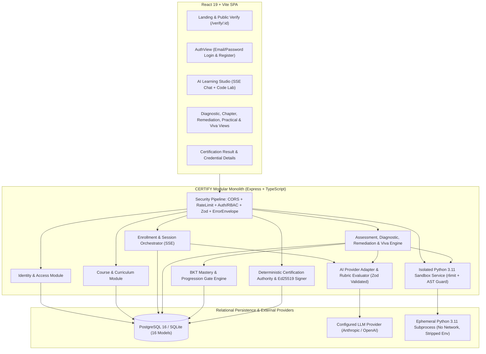

# CERTIFY — Production Implementation Blueprint

**Document Path:** `docs/CERTIFY_PRODUCTION_IMPLEMENTATION_BLUEPRINT.md`  
**Version:** `2026.10-PRODUCTION`  
**Status:** `AUTHORITATIVE TECHNICAL BLUEPRINT`

---

## 1. Executive Summary
CERTIFY is a course-first AI learning and certification platform built around the progression **LEARN → DEMONSTRATE → EARN**. This blueprint defines the complete production architecture, domain boundaries, database schema, AI orchestration contract, deterministic certification engine, isolated Python practical execution runner, Ed25519 credential signing pipeline, security threat model, and phased implementation plan.

## 2. Canonical Product Definition
- **Core Journey:** Register/Sign In → Explore Curated Courses (`Python Fundamentals` v1.0.0) → Inspect Syllabus → Enroll → Complete Baseline Diagnostic → Learn via Interactive Socratic AI Tutor → Answer Formative Probes → Complete Chapter Assessments → Receive Targeted Remediation (when needed) → Unlock Next Chapters via Deterministic Gates → Complete Final Practical Task in Isolated Sandbox → Defend Decisions in Multi-Turn AI Viva → Receive Deterministic Certification Decision → Share & Publicly Verify Ed25519-Signed Credential.
- **Non-Negotiable Trust Boundary:** The AI tutor teaches, explains, probes, and produces structured criterion-level evaluation evidence validated by strict server-side Zod schemas. **The LLM never independently authorizes a chapter unlock or issues a certificate.**

## 3. Explicit Scope and Non-Goals
- **In V1 Scope:** Platform-owned curated courses (`Python Fundamentals`), Socratic text-first AI tutoring over SSE, baseline diagnostic calibration, criterion-level chapter assessments, targeted misconception remediation, isolated Python 3.11 practical code execution, multi-turn persisted AI Viva defense, deterministic certification rules (`FOUNDATION`, `PROFICIENT`, `ADVANCED`), Ed25519 digital signing + DB status registry, public verification without PII leakage, and admin credential revocation.
- **Explicitly Deferred / Non-Goals:** User-uploaded/BYO courses, arbitrary skill testing marketplace, recruiter job boards/leaderboards, webcam/biometric surveillance proctoring, blockchain/NFT ledgers, native mobile apps, and real-time voice TTS/STT.

## 4. Existing Repository Structure
```text
certify-main/
├── backend/
│   ├── prisma/
│   │   ├── schema.prisma        # 16 relational models
│   │   └── seed.ts              # Flagship Python Fundamentals seed (8 modules, 9 chapters, 10 concepts)
│   ├── src/
│   │   ├── config/index.ts      # Environment & cryptographic key configuration
│   │   ├── shared/              # Prisma client, auth/RBAC middleware, rate limiter, logger, error handler
│   │   ├── modules/
│   │   │   ├── auth/            # Registration, login, profile (/api/v1/auth)
│   │   │   ├── courses/         # Catalog, syllabus, enrollment (/api/v1/courses)
│   │   │   ├── sessions/        # Learning studio context, SSE tutor stream, chapter progression
│   │   │   ├── ai/              # Vendor-neutral LLM provider adapter & structured rubric evaluator
│   │   │   ├── assessment/      # Diagnostic, chapter assessments, remediation, viva defense
│   │   │   ├── mastery/         # BKT mathematical engine & deterministic CertificationEvaluator
│   │   │   ├── sandbox/         # Isolated Python 3.11 subprocess runner with rlimit & AST guard
│   │   │   └── certificates/    # Evidence aggregation, Ed25519 signing, public verification, revocation
│   │   ├── app.ts               # Express application & middleware pipeline
│   │   └── server.ts            # HTTP server entrypoint
├── frontend/
│   ├── src/
│   │   ├── components/          # 19 views (Landing, Auth, Dashboard, Catalog, Studio, Assessments, Verify)
│   │   ├── services/api.ts      # Typed REST + SSE client
│   │   ├── types/index.ts       # Shared DTO interfaces
│   │   └── App.tsx              # Client router & auth guard
└── docs/                        # Canonical audit, architecture, blueprint, task sheet, test plan, progress
```

## 5. Verified Current-State Audit Summary
See `docs/CERTIFY_END_TO_END_AUDIT.md` for full file-and-line citations:
- **Confirmed Working in Baseline:** `bkt.ts` math (8 unit tests), `seed.ts` curriculum hierarchy, `auth` register/login/me, `courses` list/detail/enroll, `sessions` context hydration.
- **Confirmed Defective in Baseline (Remediated in Phase 9):** IDOR on `sessions` and `assessments` endpoints; mocked 11-keyword tutor in `sessions.controller.ts` directly awarding BKT mastery; 15-keyword grading and nested-loop multiplication in `assessment.controller.ts`; hardcoded `0.92, 0.88, 0.86, 0.82` scores in `certificates.controller.ts`; unverified `HMAC-SHA256` labeled as `Ed25519`; missing `/api/v1/execute` sandbox, diagnostic, and remediation routes; `AuthView.tsx` 1-click shared login and unmounted `/verify` route.

## 6. Feature-Status Matrix Summary
| Feature Domain | Pre-Remediation Status | Target Post-Remediation Status |
| :--- | :--- | :--- |
| Identity, Auth & Resource Ownership | `PARTIALLY IMPLEMENTED` (IDOR & UI bypass) | `VERIFIED COMPLETE` |
| Curated Course Catalog & Enrollment | `PARTIALLY IMPLEMENTED` | `VERIFIED COMPLETE` |
| Baseline Diagnostic Calibration | `MOCKED / HARDCODED` | `VERIFIED COMPLETE` |
| Socratic AI Tutor & SSE Streaming | `MOCKED / HARDCODED` | `VERIFIED COMPLETE` |
| Chapter Assessments & Rubric Evaluator | `MOCKED / HARDCODED` | `VERIFIED COMPLETE` |
| Misconception Remediation Loop | `MOCKED / HARDCODED` | `VERIFIED COMPLETE` |
| Mastery & Progression Gates | `PARTIALLY IMPLEMENTED` | `VERIFIED COMPLETE` |
| Isolated Practical Code Sandbox | `MISSING` | `VERIFIED COMPLETE` |
| Multi-Turn Persisted AI Viva | `MOCKED / HARDCODED` | `VERIFIED COMPLETE` |
| Deterministic Certification & Ed25519 Verification | `MOCKED / HARDCODED` | `VERIFIED COMPLETE` |

## 7. Chosen Technology Stack
- **Frontend:** React 19.2 + Vite 8.3 + TypeScript 5.6
- **Backend:** Node.js 20 LTS + Express 4.21 + TypeScript 5.6 + Zod 3.23
- **Database & ORM:** PostgreSQL 16 (Prod/Staging) / SQLite 3 (Local Dev/Offline Test Parity) + Prisma 5.20
- **AI Orchestration:** Vendor-neutral `AIProvider` adapter (`Anthropic Claude 3.5 Sonnet/Haiku` & `OpenAI GPT-4o/4o-mini` via native `fetch` + `AbortController` + strict Zod output validation)
- **Code Execution Sandbox:** Isolated Python 3.11 worker subprocess with OS `resource.setrlimit` (`CPU=2s`, `AS=128MB`, `NPROC=0`, `FSIZE=1MB`), AST security guard, stripped environment, and 3s wall-clock kill timer
- **Cryptography:** Native Node `crypto` `Ed25519` asymmetric keypair signing + database status registry

## 8. Stack Decision Matrix
Refer to `docs/CERTIFY_ARCHITECTURE_DECISIONS.md` Section 2 for the complete 19-layer decision matrix.

## 9. Architecture & Component Diagrams



## 10. Domain Module Responsibilities (Phase 6 Modules A–K)

| Module | Owned Data Models | Core Responsibilities & Service Interfaces | Failure Cases Handled |
| :--- | :--- | :--- | :--- |
| **A. Identity & Access (`modules/auth`)** | `User` | `register()`, `login()`, `getMe()`, `requireAuth`, `requireRole()`, `verifyEnrollmentOwnership()`. | Duplicate email (`400`), invalid credentials (`401`), expired JWT (`401`), cross-user IDOR (`403`), brute-force rate limit (`429`). |
| **B. Course & Curriculum (`modules/courses`)** | `Course`, `CourseVersion`, `Module`, `Chapter`, `Concept`, `Rubric`, `RubricCriterion`, `Question` | `listCourses()`, `getCourseBySlug()`, curriculum lookup by active version. | Unknown slug (`404`), unpublished course filtering. |
| **C. Enrollment & Learner State (`modules/sessions`)** | `Enrollment`, `LearningSession`, `ChatMessage` | Idempotent `enroll()`, `getSessionContext()`, session phase tracking (`DIAGNOSTIC`, `TEACHING`, `REMEDIATING`, `ASSESSING`). | Unauthorized session access (`403`), missing chapter (`404`). |
| **D. AI Orchestration (`modules/ai`)** | `ChatMessage.metadata` | `streamTutorResponse()`, `evaluateCriterionAnswer()`, `evaluateVivaTurn()`. Enforces role separation and Zod output validation. | Missing API key in prod (`503`), upstream timeout (`504`), malformed JSON output (fails closed), client disconnect (`AbortController`). |
| **E. Assessment & Diagnostic (`modules/assessment`)** | `AssessmentAttempt`, `AssessmentAnswer`, `RubricEvaluation` | `getDiagnosticQuestions()`, `submitDiagnostic()`, `getChapterQuestions()`, `submitChapterAssessment()`, `getRemediationPlan()`, `submitRemediationCheck()`. | Negated answers, partial credit, cross-user submission (`403`), transaction rollback on DB failure. |
| **F. Mastery & Progression (`modules/mastery`)** | `ConceptMastery`, `MasteryEvidence` | `BayesianKnowledgeTracer.update()`, `advanceChapter()` gate (`pMastery >= 0.70` and no `NEEDS_REMEDIATION` state). | Premature advance blocked (`400` with `unmasteredConcepts` list). |
| **G. Practical Assessment (`modules/sandbox`)** | `AssessmentAttempt (PRACTICAL)` | `executePythonCode()`, `submitPracticalAssessment()` running learner code against unit test assertions in isolated subprocess. | Syntax error, infinite loop (`3000ms` kill), memory exhaustion (`128MB` cap), forbidden imports (`socket`/`subprocess`/`os.system` blocked), oversized stdout (`16KB` cap). |
| **H. AI Viva / Defense (`modules/assessment`)** | `AssessmentAttempt (VIVA)`, `AssessmentAnswer` | Persisted 3-turn defense state machine (`conductVivaTurn()`), storing each turn's prompt, learner response, and criterion evaluation. | Skipping turns blocked; incomplete viva (`<3` turns) not marked `EVALUATED`; low reasoning depth fails threshold. |
| **I. Certification Authority (`modules/certificates`)** | `Certificate`, `Enrollment.status` | `issueCertificate()` aggregating persisted chapter mastery, practical score, viva score, consistency index, and interaction depth inside an atomic transaction. | Missing practical or viva attempt blocks issuance (`400`); idempotent return if already issued. |
| **J. Credential Verification (`modules/certificates`)** | `Certificate` | `verifyPublicCredential()`, `getPublicKey()`, `listMyCredentials()`. Re-verifies Ed25519 signature against canonical payload. | Unknown ID (`404`), revoked status (`isValid: false`), tampered DB fields (`signatureVerified: false, isValid: false`). |
| **K. Admin & Authoring (`modules/certificates` & `courses`)** | `Course`, `Certificate.status` | `revokeCredential()` (`ADMIN`/`INSTRUCTOR` only) and seeded versioned curriculum management. | Non-admin user (`403 Forbidden`). |

## 11. Database Schema & Relationship Design
All 16 relational models in `backend/prisma/schema.prisma` maintain foreign-key referential integrity:
- `User (1) ──< (N) Enrollment (N) >── (1) CourseVersion (N) >── (1) Course`
- `CourseVersion (1) ──< (N) Module (1) ──< (N) Chapter (1) ──< (N) Concept (1) ──< (N) Rubric (1) ──< (N) RubricCriterion`
- `Enrollment (1) ──< (N) LearningSession (1) ──< (N) ChatMessage`
- `Enrollment (1) ──< (N) ConceptMastery (1) ──< (N) MasteryEvidence`
- `Enrollment (1) ──< (N) AssessmentAttempt (1) ──< (N) AssessmentAnswer (1) ──< (N) RubricEvaluation`
- `Enrollment (1) ── (0..1) Certificate`

## 12. Migration and Rollback Strategy
1. **Local / Offline Sandbox Parity:** Uses SQLite (`file:./dev.db`) with identical table and column semantics so all integration tests run deterministically offline.
2. **Production PostgreSQL 16 Migration:**
   - Update `datasource db { provider = "postgresql" url = env("DATABASE_URL") }`.
   - Generate baseline migration via `npx prisma migrate diff --from-empty --to-schema-datamodel prisma/schema.prisma --script > prisma/migrations/0001_init/migration.sql`.
   - Apply in staging/production via `npx prisma migrate deploy` prior to rolling out new container instances.
   - **Rollback:** Take a pre-migration logical snapshot (`pg_dump -Fc`) before `prisma migrate deploy`; all schema additions (indexes and optional metadata JSON fields) are backward-compatible (expand-and-contract pattern).

## 13. AI Orchestration and Provider Design
- **Interface (`src/modules/ai/ai.provider.ts`):**
  - `streamTutorReply(context: TutorContext, onToken: (chunk: string) => void, signal?: AbortSignal)`
  - `evaluateRubricCriteria(context: RubricEvalContext): Promise<ValidatedRubricEval>`
  - `evaluateVivaDefenseTurn(context: VivaEvalContext): Promise<ValidatedVivaEval>`
- **Strict Separation:**
  - `streamTutorReply` is pedagogical only: it never writes to `ConceptMastery` or `MasteryEvidence`.
  - `evaluateRubricCriteria` outputs JSON validated by `RubricEvaluationOutputSchema` (`z.object({ evaluations: z.array(z.object({ criterionId: z.string(), isDemonstrated: z.boolean(), confidence: z.number().min(0).max(1), evidenceQuote: z.string(), reasoning: z.string() })) })`).

## 14. Assessment and Evaluation Design
- **Negation & Keyword-Stuffing Immunity:** The evaluator checks semantic alignment with each specific `RubricCriterion` and explicitly rejects negated statements (`not`, `don't`, `never`, `no idea`, `confused`, `doesn't`) or short/repetitive keyword stuffing.
- **Per-Question Concept Mapping:** Each question in a chapter assessment evaluates only the criteria mapped to its target concept(s), preventing the nested-loop multiplication bug found in the audit.

## 15. Mastery Model Decision and Justification
- Uses standard Corbett & Anderson BKT (`pT=0.20, pG=0.10, pS=0.05`, clamped to `[0.01, 0.99]`) initialized at `0.15` (or calibrated via Baseline Diagnostic in `[0.10, 0.45]`).
- Updated **only** on validated assessment events (`DIAGNOSTIC`, `CHAPTER`, `REMEDIATION`).
- When a chapter assessment criterion is not demonstrated and posterior $P(L) < 0.70$, `ConceptMastery.state` transitions to `"NEEDS_REMEDIATION"` and `remediationCycles` increments.

## 16. Deterministic Certification Specification
The certification engine (`CertificatesController.issueCertificate` + `CertificationEvaluator.evaluateCredential`) computes 5 real evidence signals from the learner's persisted database records:
1. **`chapterMasteryScore` (Weight 30%):** Mean `pMastery` across all course concepts. **Hard Gate:** Every concept in the course must have `pMastery >= 0.70` and at least one evaluated `CHAPTER` assessment attempt must exist.
2. **`practicalPerformance` (Weight 25%):** Highest score from evaluated `AssessmentAttempt` rows with `assessmentType = "PRACTICAL"` for this enrollment. **Hard Gate:** Must exist and be `>= 0.70` (`>= 0.80` for `PROFICIENT`, `>= 0.90` for `ADVANCED`).
3. **`vivaDefenseScore` (Weight 20%):** Highest score from completed `AssessmentAttempt` rows with `assessmentType = "VIVA"` and `status = "EVALUATED"` (requiring all 3 defense turns). **Hard Gate:** Must exist and be `>= 0.70` (`>= 0.75` for `PROFICIENT`, `>= 0.90` for `ADVANCED`).
4. **`consistencyIndex` (Weight 15%):** Computed from persisted chapter assessment attempt scores $S_1, \dots, S_k$:
   $$\text{consistencyIndex} = \max\left(0, \min\left(1, \bar{S} \cdot (1 - \sigma(S))\right)\right)$$
5. **`interactionDepthScore` (Weight 10%):** Computed from persisted learner chat turns (`ChatMessage` where `sender = "USER"`) and demonstrated `MasteryEvidence` records across chapters, capped at `1.0`.

## 17. Credential Verification Design
- **Identifier Format:** `CERT-YYYY-PY-<12-HEX-CHARS>` (48 bits of CSPRNG entropy via `crypto.randomBytes(6)`).
- **Digital Signature:** Ed25519 signature over canonical JSON snapshot stored in `Certificate.signatureHash` (`ed25519:<base64_signature>`), with public key exposed at `GET /api/v1/certificates/public-key`.
- **Verification Endpoint (`GET /api/v1/certificates/:credentialId/verify`):** Recomputes canonical payload, verifies Ed25519 signature with the public key, checks `status === "VALID"`, and returns `isValid: certificate.status === "VALID" && signatureVerified`.

## 18. API Specification Summary (`/api/v1`)
| Endpoint | Method | Auth | Purpose |
| :--- | :--- | :--- | :--- |
| `/api/v1/health` | `GET` | Public | Liveness & readiness health check |
| `/api/v1/auth/register` | `POST` | Public | Register new learner account |
| `/api/v1/auth/login` | `POST` | Public | Authenticate and issue JWT |
| `/api/v1/auth/me` | `GET` | Bearer | Current user profile, enrollments & credentials |
| `/api/v1/courses` | `GET` | Public | List published courses |
| `/api/v1/courses/:slug` | `GET` | Public | Full versioned course syllabus |
| `/api/v1/courses/:slug/enroll` | `POST` | Bearer | Idempotent course enrollment & BKT initialization |
| `/api/v1/courses/:slug/diagnostic` | `GET` | Bearer | Fetch course-grounded baseline diagnostic questions |
| `/api/v1/assessments/diagnostic/submit` | `POST` | Bearer (Owner) | Grade diagnostic & calibrate initial BKT priors |
| `/api/v1/courses/:slug/session` | `GET` | Bearer (Owner) | Hydrate active learning session, messages & masteries |
| `/api/v1/sessions/:sessionId/messages` | `POST` | Bearer (Owner) | Stream Socratic AI tutor response over SSE |
| `/api/v1/sessions/:sessionId/advance` | `POST` | Bearer (Owner) | Gate-checked advancement to next chapter |
| `/api/v1/sessions/:sessionId/remediation` | `GET` | Bearer (Owner) | Fetch targeted remediation plan for weak concepts |
| `/api/v1/assessments/remediation/submit` | `POST` | Bearer (Owner) | Submit remediation recovery check & clear remediation flag |
| `/api/v1/assessments/chapters/:chapterId` | `GET` | Bearer | Fetch chapter assessment questions |
| `/api/v1/assessments/chapters/:chapterId/submit` | `POST` | Bearer (Owner) | Evaluate chapter assessment criteria & update BKT atomically |
| `/api/v1/execute` | `POST` | Bearer | Execute Python 3 code in isolated resource-limited sandbox |
| `/api/v1/assessments/practical/submit` | `POST` | Bearer (Owner) | Run capstone code against unit test suite & persist `PRACTICAL` attempt |
| `/api/v1/assessments/final/viva` | `POST` | Bearer (Owner) | Persisted multi-turn AI viva defense state machine |
| `/api/v1/certificates/issue` | `POST` | Bearer (Owner) | Deterministic evidence-derived credential issuance & Ed25519 signing |
| `/api/v1/certificates/mine` | `GET` | Bearer (Owner) | List authenticated learner's issued credentials |
| `/api/v1/certificates/public-key` | `GET` | Public | Export Ed25519 SPKI public key PEM for independent verification |
| `/api/v1/certificates/:credentialId/verify` | `GET` | Public | Verify credential status & Ed25519 cryptographic signature |
| `/api/v1/certificates/:credentialId/revoke` | `POST` | Bearer (`ADMIN`/`INSTRUCTOR`) | Revoke a credential with reason & audit timestamp |

## 19. Authentication and Authorization Model
- **Authentication:** Bearer JWT verified via `requireAuth`. Production startup refuses to boot if `JWT_SECRET` is unset or equals the development fallback.
- **Resource Ownership (`IDOR` Prevention):** Every session, assessment, practical, viva, and certificate endpoint queries the parent `Enrollment` and asserts `enrollment.userId === req.user.id`, returning `403 Forbidden` on mismatch.
- **Role-Based Access Control (`RBAC`):** `requireRole(["ADMIN", "INSTRUCTOR"])` guards administrative actions such as credential revocation.

## 20. Security Threat Model
| Threat | Mitigation Implemented |
| :--- | :--- |
| Cross-user IDOR on sessions/assessments | Explicit `enrollment.userId === req.user.id` check in every controller/service before read or mutation. |
| Remote Code Execution via Python sandbox | Stripped `env`, AST blacklist (`socket`, `subprocess`, `os.system`, `ctypes`, `urllib`, `shutil`), OS `rlimit` (`CPU=2s`, `AS=128MB`, `NPROC=0`), `3s` SIGKILL timer, `16KB` output cap. |
| Prompt injection / keyword gaming | Role-separated system prompts, negation detection, per-criterion semantic evaluation, and zero BKT updates from free-form tutor chat. |
| Credential forgery / DB tampering | Ed25519 digital signature over canonical JSON snapshot verified on every `/verify` call. |
| Brute-force & API flooding | Sliding-window rate limiter middleware on auth, AI streaming, and code execution endpoints. |

## 21. Practical-Execution Isolation Design
Learner Python submissions are executed via `SandboxService.executePython()` (`backend/src/modules/sandbox/sandbox.service.ts`):
1. **Static AST & Token Pre-Check:** Rejects code importing or referencing restricted modules/builtins (`socket`, `subprocess`, `pty`, `ctypes`, `multiprocessing`, `urllib`, `http`, `ftplib`, `telnetlib`, `shutil`, ` eval(`, `exec(`, `open(`, `__import__`).
2. **OS-Level Resource Limits Wrapper:** Runs inside a dedicated temporary directory (`/tmp/certify-sandbox-<uuid>`) with a Python wrapper that invokes `resource.setrlimit` (`RLIMIT_CPU = (2, 2)`, `RLIMIT_AS = (134217728, 134217728)`, `RLIMIT_FSIZE = (1048576, 1048576)`, `RLIMIT_NPROC = (0, 0)`) before executing learner code.
3. **Stripped Process Environment & Timeout:** `child_process.spawn("python3", ["-I", "-B", runnerPath], { cwd: tempDir, env: { PATH: "/usr/bin:/bin", PYTHONDONTWRITEBYTECODE: "1" } })` with a 3,000ms wall-clock `SIGKILL` timer and 16KB stdout/stderr truncation, followed by `fs.rmSync(tempDir, { recursive: true, force: true })` in `finally`.

## 22. Failure Handling and Recovery
- **AI Provider Failures:** Timeouts (`AbortSignal.timeout`) and HTTP 429/5xx errors return structured `503`/`504` error envelopes without corrupting session history or awarding false mastery.
- **Database Transaction Failures:** Multi-step assessment evaluations and credential issuance run inside `prisma.$transaction`, rolling back completely on partial failure.
- **SSE Disconnects:** `req.on("close")` aborts upstream generation and avoids writing truncated assistant messages as completed turns.

## 23. Observability
- **Structured Logging (`src/shared/logger.ts`):** Logs JSON events with `timestamp`, `level`, `requestId`, `method`, `path`, `userId`, `statusCode`, `durationMs`, and redacts sensitive keys (`password`, `token`, `authorization`, `apiKey`).
- **Health Signal (`GET /api/v1/health`):** Reports service status, uptime, database connectivity, and AI provider configuration mode.

## 24. Testing Strategy
See `docs/CERTIFY_END_TO_END_TEST_PLAN.md` for the full 7-layer test specification (Unit, Integration, Access-Control/IDOR, AI Evaluation/Negation, Sandbox Security, Cryptographic Verification, and End-to-End Learner Journey).

## 25. Deployment Architecture
- **Containerization:** Multi-stage `Dockerfile` (Node 20 + Python 3.11 runtime) and `docker-compose.yml` (Backend API + Frontend Nginx/static + PostgreSQL 16 with healthchecks).
- **Reverse Proxy / TLS:** Terminate TLS 1.3 at edge proxy (Cloudflare / ALB / Caddy) with `X-Content-Type-Options: nosniff`, `X-Frame-Options: DENY`, `Referrer-Policy: strict-origin-when-cross-origin`, and SSE proxy buffering disabled (`X-Accel-Buffering: no`).

## 26. Environment and Secret Management
Required production variables (documented in `backend/.env.example`):
- `NODE_ENV=production`
- `PORT=5000`
- `DATABASE_URL=postgresql://...`
- `JWT_SECRET=<32+ byte random secret>`
- `ED25519_PRIVATE_KEY_PEM=<PEM>` & `ED25519_PUBLIC_KEY_PEM=<PEM>`
- `AI_PROVIDER=anthropic|openai` & `ANTHROPIC_API_KEY` / `OPENAI_API_KEY`
- `CORS_ORIGIN=https://app.certify.edu`

## 27. Backup and Restoration
- **Automated Daily Snapshots + WAL Archiving:** Managed PostgreSQL PITR (Point-in-Time Recovery) with 14-day retention plus daily encrypted `pg_dump -Fc` snapshots.
- **Restore Verification:** Monthly automated restore rehearsal into an isolated staging DB followed by running the credential verification smoke suite.

## 28. Cost and Scaling Considerations
- **AI Token Controls:** Enforce max message input length (`4,000` chars), sliding conversation context window (last 10 messages), and per-user rate limits (`20` messages / 15 min).
- **Sandbox Concurrency:** Limit concurrent Python subprocesses to `4` per backend instance; scale horizontally behind load balancer when CPU utilization exceeds 65%.

## 29. Implementation Milestones
1. **Milestone 1 (P0 Security & Ownership):** Fix IDOR across all endpoints, harden JWT/Auth config, add rate limiting, Zod validation, and structured error middleware.
2. **Milestone 2 (P0 AI Provider & Rubric Evaluator):** Build `ai.provider.ts`, decouple tutor chat from BKT mutations, implement negation-aware criterion-level evaluator and per-question concept mapping.
3. **Milestone 3 (P1 Complete Learner Loop & Sandbox):** Add Diagnostic, Remediation, Isolated Python Sandbox (`/api/v1/execute` & `/api/v1/assessments/practical/submit`), and persisted 3-turn Viva state machine.
4. **Milestone 4 (P0 Evidence-Derived Certification & Ed25519):** Remove all hardcoded constants in `certificates.controller.ts`, aggregate real DB evidence, implement Ed25519 signing/verification and admin revocation.
5. **Milestone 5 (P1 Frontend Integration & Public Verify):** Restore real Email/Password Login & Register in `AuthView.tsx`, mount `PublicVerifyView.tsx` at `/verify`, and wire Diagnostic, Chapter Assessment, Remediation, Final Practical/Viva, Result, and Credentials views to live backend APIs.
6. **Milestone 6 (P1/P2 Testing & Deployment Artifacts):** Execute full automated test suite (Unit, IDOR, Negation, Sandbox, E2E Learner Journey) and add `Dockerfile`, `docker-compose.yml`, and `.github/workflows/ci.yml`.

## 30. Acceptance Criteria
All 12 criteria in Phase 12 (Definition of Production Ready) must be verified by automated tests and recorded in `docs/CERTIFY_IMPLEMENTATION_PROGRESS.md`.

## 31. Technical Risks and Mitigations
| Risk | Mitigation |
| :--- | :--- |
| LLM latency or outage during chapter assessment | Explicit 8s timeout, structured retryable error response, and zero partial DB corruption via `$transaction`. |
| Subprocess resource contention under load | Concurrency semaphore + strict 2s CPU / 3s wall-clock `SIGKILL` + 128MB memory cap. |
| Ed25519 key rotation | Include `keyId` and `algorithm: "Ed25519"` in credential metadata so historical public keys remain verifiable during rotation. |

## 32. Open Questions for Product Owner
1. **Calibrated Cut-Scores:** Are the composite tier thresholds (`0.70` Foundation, `0.85` Proficient, `0.92` Advanced) and weights (`30% / 25% / 20% / 15% / 10%`) final for the first external learner cohort, or should they be adjusted after pilot cohort psychometric review?
2. **Credential Expiry Policy:** Should Python Fundamentals credentials remain valid indefinitely unless revoked (`expiresAt: null`), or expire after 24 months?
