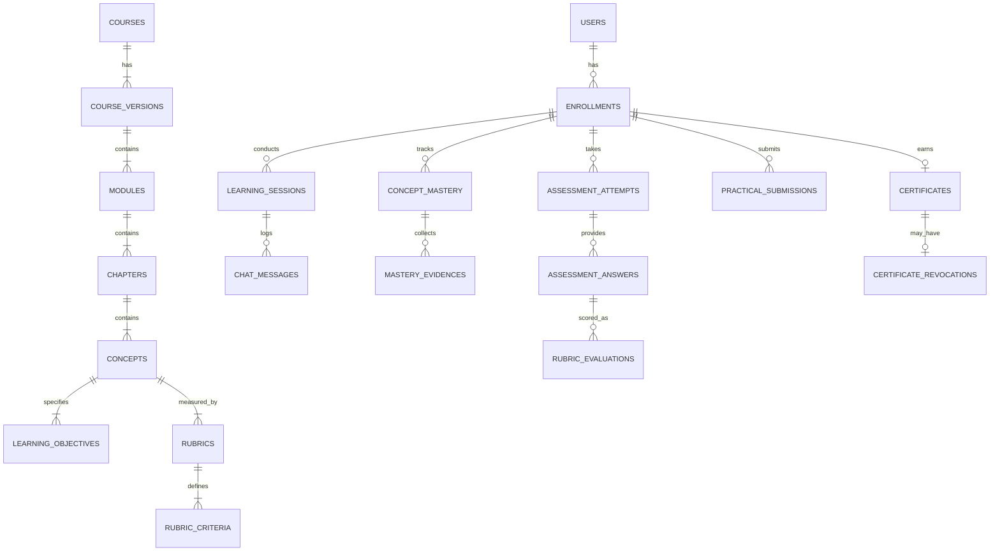

# Database Architecture & Relational Schema Specification

## 1. Database Selection: PostgreSQL 16+ with pgvector

### Why PostgreSQL over MongoDB
While MongoDB is familiar in MERN development, it is fundamentally misaligned with Certify's requirements:
1. **Relational Rigor**: Educational curricula are deeply relational (Courses $\rightarrow$ Modules $\rightarrow$ Chapters $\rightarrow$ Concepts $\rightarrow$ Objectives $\rightarrow$ Rubrics $\rightarrow$ Criteria). In Mongo, either massive nesting leads to document size limits and concurrency collisions, or manual references lead to application-level join fragility.
2. **ACID Transaction Boundaries**: Issuing a credential, locking an assessment attempt, and updating Bayesian Knowledge Tracing scores require atomic transactions to prevent race conditions and duplicate certificate generation.
3. **Consolidated Vector Storage with `pgvector`**: PostgreSQL allows vector embeddings of course content to live in the exact same database as the course chapters. RAG queries perform unified SQL queries joining metadata filters (`course_id = ... AND chapter_id = ...`) with cosine distance ordering in a single execution plan without an external vector database.

---

## 2. Entity-Relationship Overview



---

## 3. Core Table Definitions (PostgreSQL DDL)

```sql
-- Enable necessary extensions
CREATE EXTENSION IF NOT EXISTS "uuid-ossp";
CREATE EXTENSION IF NOT EXISTS "vector";

-- 1. USERS & ROLES
CREATE TABLE users (
    id UUID PRIMARY KEY DEFAULT uuid_generate_v4(),
    email VARCHAR(255) UNIQUE NOT NULL,
    password_hash VARCHAR(255) NOT NULL,
    full_name VARCHAR(255) NOT NULL,
    role VARCHAR(50) NOT NULL DEFAULT 'STUDENT', -- STUDENT, INSTRUCTOR, ADMIN
    created_at TIMESTAMPTZ NOT NULL DEFAULT NOW(),
    updated_at TIMESTAMPTZ NOT NULL DEFAULT NOW()
);

-- 2. COURSES & VERSIONS
CREATE TABLE courses (
    id UUID PRIMARY KEY DEFAULT uuid_generate_v4(),
    slug VARCHAR(100) UNIQUE NOT NULL,
    title VARCHAR(255) NOT NULL,
    summary TEXT NOT NULL,
    description TEXT NOT NULL,
    status VARCHAR(50) NOT NULL DEFAULT 'DRAFT', -- DRAFT, REVIEW, PUBLISHED, ARCHIVED
    created_at TIMESTAMPTZ NOT NULL DEFAULT NOW(),
    updated_at TIMESTAMPTZ NOT NULL DEFAULT NOW()
);

CREATE TABLE course_versions (
    id UUID PRIMARY KEY DEFAULT uuid_generate_v4(),
    course_id UUID NOT NULL REFERENCES courses(id) ON DELETE CASCADE,
    version_number VARCHAR(20) NOT NULL, -- e.g., '1.0.0'
    changelog TEXT,
    is_active BOOLEAN NOT NULL DEFAULT FALSE,
    created_at TIMESTAMPTZ NOT NULL DEFAULT NOW(),
    UNIQUE(course_id, version_number)
);

-- 3. CURRICULUM HIERARCHY
CREATE TABLE modules (
    id UUID PRIMARY KEY DEFAULT uuid_generate_v4(),
    course_version_id UUID NOT NULL REFERENCES course_versions(id) ON DELETE CASCADE,
    title VARCHAR(255) NOT NULL,
    sequence_order INT NOT NULL,
    created_at TIMESTAMPTZ NOT NULL DEFAULT NOW()
);

CREATE TABLE chapters (
    id UUID PRIMARY KEY DEFAULT uuid_generate_v4(),
    module_id UUID NOT NULL REFERENCES modules(id) ON DELETE CASCADE,
    title VARCHAR(255) NOT NULL,
    sequence_order INT NOT NULL,
    teaching_content TEXT NOT NULL,
    created_at TIMESTAMPTZ NOT NULL DEFAULT NOW()
);

CREATE TABLE concepts (
    id UUID PRIMARY KEY DEFAULT uuid_generate_v4(),
    chapter_id UUID NOT NULL REFERENCES chapters(id) ON DELETE CASCADE,
    slug VARCHAR(100) NOT NULL,
    name VARCHAR(255) NOT NULL,
    description TEXT NOT NULL,
    sequence_order INT NOT NULL,
    created_at TIMESTAMPTZ NOT NULL DEFAULT NOW(),
    UNIQUE(chapter_id, slug)
);

CREATE TABLE rubrics (
    id UUID PRIMARY KEY DEFAULT uuid_generate_v4(),
    concept_id UUID NOT NULL REFERENCES concepts(id) ON DELETE CASCADE,
    title VARCHAR(255) NOT NULL,
    created_at TIMESTAMPTZ NOT NULL DEFAULT NOW()
);

CREATE TABLE rubric_criteria (
    id UUID PRIMARY KEY DEFAULT uuid_generate_v4(),
    rubric_id UUID NOT NULL REFERENCES rubrics(id) ON DELETE CASCADE,
    criterion_statement TEXT NOT NULL,
    weight NUMERIC(4, 2) NOT NULL DEFAULT 1.0,
    tier_required VARCHAR(50) NOT NULL DEFAULT 'EASY', -- EASY, MEDIUM, HARD
    created_at TIMESTAMPTZ NOT NULL DEFAULT NOW()
);

-- 4. RAG KNOWLEDGE VECTORS
CREATE TABLE course_embeddings (
    id UUID PRIMARY KEY DEFAULT uuid_generate_v4(),
    chapter_id UUID NOT NULL REFERENCES chapters(id) ON DELETE CASCADE,
    concept_id UUID REFERENCES concepts(id) ON DELETE SET NULL,
    content_chunk TEXT NOT NULL,
    embedding vector(1536), -- OpenAI text-embedding-3-small
    created_at TIMESTAMPTZ NOT NULL DEFAULT NOW()
);

CREATE INDEX idx_embeddings_vector ON course_embeddings USING hnsw (embedding vector_cosine_ops);

-- 5. ENROLLMENTS & MASTERY
CREATE TABLE enrollments (
    id UUID PRIMARY KEY DEFAULT uuid_generate_v4(),
    user_id UUID NOT NULL REFERENCES users(id) ON DELETE CASCADE,
    course_version_id UUID NOT NULL REFERENCES course_versions(id) ON DELETE RESTRICT,
    status VARCHAR(50) NOT NULL DEFAULT 'ACTIVE', -- ACTIVE, COMPLETED, DROPPED
    current_chapter_id UUID REFERENCES chapters(id),
    current_tier VARCHAR(50) NOT NULL DEFAULT 'EASY', -- EASY, MEDIUM, HARD
    enrolled_at TIMESTAMPTZ NOT NULL DEFAULT NOW(),
    completed_at TIMESTAMPTZ,
    UNIQUE(user_id, course_version_id)
);

CREATE TABLE concept_mastery (
    id UUID PRIMARY KEY DEFAULT uuid_generate_v4(),
    enrollment_id UUID NOT NULL REFERENCES enrollments(id) ON DELETE CASCADE,
    concept_id UUID NOT NULL REFERENCES concepts(id) ON DELETE CASCADE,
    p_mastery NUMERIC(5, 4) NOT NULL DEFAULT 0.1500, -- Bayesian Probability [0.0 - 1.0]
    confidence NUMERIC(5, 4) NOT NULL DEFAULT 0.2000,
    state VARCHAR(50) NOT NULL DEFAULT 'UNENCOUNTERED', -- UNENCOUNTERED, LEARNING, NEEDS_REMEDIATION, MASTERED, ADVANCED
    remediation_cycles INT NOT NULL DEFAULT 0,
    last_assessed_at TIMESTAMPTZ,
    UNIQUE(enrollment_id, concept_id)
);

CREATE TABLE mastery_evidences (
    id UUID PRIMARY KEY DEFAULT uuid_generate_v4(),
    concept_mastery_id UUID NOT NULL REFERENCES concept_mastery(id) ON DELETE CASCADE,
    rubric_criterion_id UUID REFERENCES rubric_criteria(id),
    evidence_type VARCHAR(50) NOT NULL, -- DIALOGUE_PROBE, CHAPTER_ASSESSMENT, PRACTICAL_TASK, VIVA
    is_demonstrated BOOLEAN NOT NULL,
    evidence_quote TEXT,
    evaluator_reasoning TEXT,
    created_at TIMESTAMPTZ NOT NULL DEFAULT NOW()
);

-- 6. CERTIFICATES & PUBLIC CREDENTIALS
CREATE TABLE certificates (
    id UUID PRIMARY KEY DEFAULT uuid_generate_v4(),
    credential_id VARCHAR(100) UNIQUE NOT NULL, -- e.g., 'CERT-2026-PY-98124'
    enrollment_id UUID UNIQUE NOT NULL REFERENCES enrollments(id) ON DELETE RESTRICT,
    tier VARCHAR(50) NOT NULL, -- FOUNDATION, PROFICIENT, ADVANCED
    composite_score NUMERIC(5, 4) NOT NULL,
    evidence_summary JSONB NOT NULL,
    signature_hash TEXT NOT NULL,
    status VARCHAR(50) NOT NULL DEFAULT 'VALID', -- VALID, REVOKED, SUSPENDED
    issued_at TIMESTAMPTZ NOT NULL DEFAULT NOW()
);

CREATE INDEX idx_certificates_credential_id ON certificates(credential_id);
```
