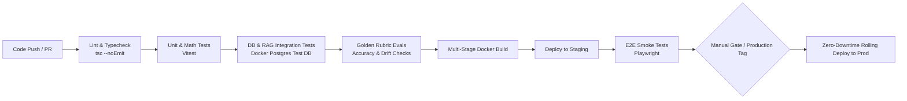

# Deployment & Infrastructure Specification

## 1. Environment Topology

```
+----------------------------------------------------------------------------------------------------+
|                                    ENVIRONMENTS & PROMOTION                                         |
+----------------------------------------------------------------------------------------------------+
| DEVELOPMENT (Local)         STAGING (Cloud Pre-prod)          PRODUCTION (Global Public)          |
| - Local Docker Compose      - Ephemeral PR Previews           - Multi-AZ Container Cluster         |
| - Mock LLM / Live Dev Keys  - Mirrored Schema & Seed Data     - High-Availability Postgres + pgvec |
| - Fast Hot Reload           - Golden Eval Suite Runs          - Redis Cluster with Auto-failover   |
+----------------------------------------------------------------------------------------------------+
```

---

## 2. CI/CD Pipeline (GitHub Actions)



---

## 3. Practical Cloud Architecture Recommendation

### MVP & Early Stage (Fastest Velocity, Lowest Operational Overhead)
* **Application Monolith**: Managed container runtime (e.g., AWS App Runner, Railway, or Render).
* **Managed Database**: Managed PostgreSQL 16 with `pgvector` enabled (AWS RDS PostgreSQL or Neon/Supabase).
* **Managed Cache**: Upstash Redis or AWS ElastiCache.
* **Storage**: Cloudflare R2 (S3-compatible, zero egress fees for certificate PDFs and assets).
* **DNS & CDN**: Cloudflare WAF + CDN.

### Production Enterprise Scale (100k+ Users)
* **Compute**: AWS ECS Fargate with Application Load Balancer across 3 Availability Zones.
* **Database**: AWS Aurora PostgreSQL Serverless v2 with Read Replicas.
* **Queue**: AWS SQS or BullMQ on Redis for asynchronous rubric evaluations.

---

## 4. Disaster Recovery & Database Backups
* **Automated Daily Backups**: 30-day retention with cross-region replication.
* **Point-In-Time Recovery (PITR)**: Write-Ahead Logging (WAL) archiving enabling recovery to any second in the previous 7 days.
* **Zero-Downtime Migrations**: Expand-and-contract schema migrations run prior to application container cutover.
