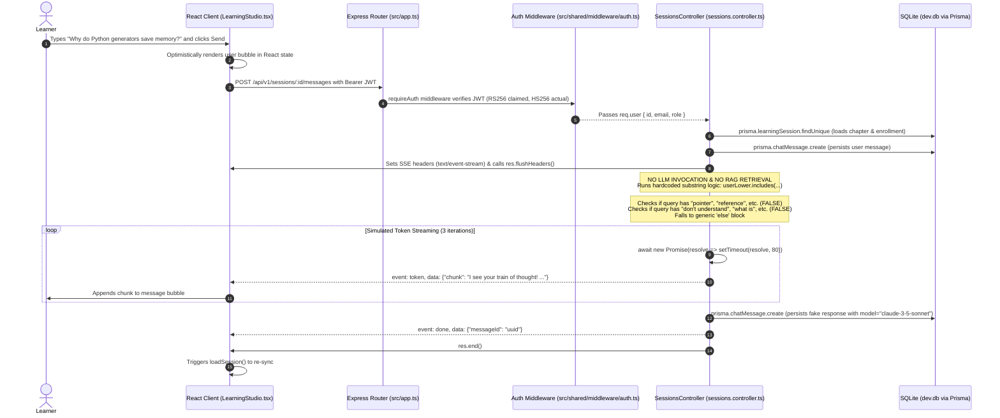

# Comprehensive Implementation & Production-Readiness Audit: Certify

**Audit Date**: September 22, 2026  
**Auditor**: Principal Systems Architect & Security Auditor  
**Scope**: Full repository audit of `certify` (`/backend`, `/frontend`, `/prisma`, `/docs`)  
**Verdict**: **PROTOTYPE DEMONSTRATOR ONLY — NOT PRODUCTION READY**

---

## 1. Executive Summary of Audit

The Certify repository contains an impressive, well-structured architectural specification and an aesthetically polished prototype demonstrator. However, a rigorous code-level audit reveals that **the system is currently an interactive simulation rather than a functioning AI educational engine**:

1. **AI is 100% Mocked**: There is **zero integration with Claude 3.5 Sonnet, Haiku, or OpenAI**. Responses are canned string arrays selected via naive `String.includes()` substring checks, streamed via artificial `setTimeout` loops.
2. **RAG & Vector Search Do Not Exist**: While documentation describes PostgreSQL 16 with `pgvector`, HNSW indexing, and `text-embedding-3-small` embeddings, the database is actually **SQLite**, and vector tables/embeddings do not exist in the codebase.
3. **Mastery Updates are Naive Keyword Hits**: Bayesian Knowledge Tracing (BKT) math is implemented correctly in isolation, but it is fed binary observations derived from whether a student typed words like `"pointer"` or `"lazy"`. Negative statements (e.g., *"I don't understand pointers"*) falsely trigger concept mastery.
4. **Certification Signals are Hardcoded**: In `CertificatesController.issueCertificate`, 4 out of 5 composite evidence parameters (`practicalScore = 0.92`, `vivaScore = 0.88`, `consistency = 0.86`, `interactionDepth = 0.82`) are literally hardcoded constants.
5. **Security & Cryptography Divergence**: Ed25519 asymmetric signing claimed in ADR-007 is actually a symmetric HMAC-SHA256, and the public verification endpoint never verifies the hash. Authentication lacks refresh cookies, storing 7-day JWTs in `localStorage`, and session endpoints suffer from Insecure Direct Object References (IDOR).
6. **Auto-Login Bypass**: The frontend automatically logs in on mount as `learner@certify.edu` with a hardcoded password, bypassing real authentication.

---

## 2. Component Implementation Classification

| Component | Status | Classification | Key Audit Finding |
| :--- | :--- | :--- | :--- |
| **Authentication API** | PARTIAL | PRODUCTION-UNSAFE | Basic JWT register/login works; no refresh token rotation, no cookie handling, tokens stored in `localStorage`, no rate limiting. |
| **Course Catalog Engine** | REAL | PARTIAL | Database schema and seed data accurately represent curriculum hierarchy (8 modules, 9 chapters, 10 concepts, 17 questions). |
| **Course Versioning** | STUB | PARTIAL | `CourseVersion` table exists with `versionNumber`, but no authoring API, publishing workflow, or migration rules exist in code. |
| **Baseline Diagnostic** | STUB | NOT IMPLEMENTED | Documented heavily in architecture docs; zero implementation in backend routes, controller, or frontend UI. |
| **Socratic AI Tutor** | MOCKED | PRODUCTION-UNSAFE | Zero LLM calls. Hardcoded string arrays with `setTimeout` simulating streaming. Metadata falsely claims `model: "claude-3-5-sonnet-pedagogical-v1"`. |
| **RAG / Vector Retrieval** | STUB | NOT IMPLEMENTED | No pgvector, no embedding generation, no chunking pipeline, no vector similarity query in code. |
| **Learner State / Memory** | PARTIAL | PRODUCTION-UNSAFE | Redis is non-existent. Working memory is queried directly from SQLite on every request. No semantic episodic summary compression. |
| **Rubric Evaluator** | MOCKED | BROKEN | Fast model evaluator does not exist. Evaluator runs `answerLower.includes(...) > 20`, updating all concepts in a chapter indiscriminately. |
| **Bayesian Knowledge Tracer** | REAL | MATHEMATICALLY SOUND | Pure math in `bkt.ts` is correct. However, inputs are corrupted by keyword matching and double-counted across criteria. |
| **Chapter Assessment** | PARTIAL | MOCKED EVALUATION | Question retrieval and attempt persistence work; scoring is simulated via keyword matching. |
| **Practical Task Sandbox** | STUB | NOT IMPLEMENTED | No Docker container sandbox, no isolated runner, no AST parsing, no code execution pipeline. |
| **AI Viva Oral Defense** | MOCKED | SIMULATED | 3 fixed turns with hardcoded questions and static feedback strings. No contextual probing of user code. |
| **Certification Authority** | PARTIAL | PRODUCTION-UNSAFE | Deterministic threshold logic in `bkt.ts` works, but inputs are hardcoded (0.92, 0.88, 0.86, 0.82) in `certificates.controller.ts`. |
| **Credential Signing** | BROKEN | SECURITY FLAW | Claims Ed25519 asymmetric cryptography; actually uses symmetric HMAC-SHA256 with JWT secret. Verification endpoint ignores the signature. |
| **Public Verification Registry** | PARTIAL | REAL DATA / NO CRYPTO VERIFY | Endpoint returns verified record from SQLite, but never checks cryptographic integrity of `signatureHash`. |
| **Admin & Authoring Workbench**| STUB | NOT IMPLEMENTED | Documented in `API_DESIGN.md`; zero endpoints or UI views exist. |
| **Observability / Tracing** | STUB | NOT IMPLEMENTED | Zero Langfuse, OpenLIT, Prometheus, or OpenTelemetry instrumentation in code. |

---

## 3. Detailed Trace: One Complete Learner Message

**Scenario**: Learner types: `"Why do Python generators save memory?"` in active learning session for Chapter 1.



### Trace Findings:
* **LLM Call**: **NONE**. The model did not read the prompt.
* **Course Grounding (RAG)**: **NONE**. No vector search was executed.
* **Semantic Relevance**: **FAILED**. The learner asked about *generators and memory*, but the fallback response asked: *"In your own words: why did the Python language designers choose this specific behavior instead of copying values eagerly?"*
* **BKT Update**: Not triggered on this turn because keyword list did not match.

---

## 4. Deep Audit by Domain

### 4.1 AI Implementation Audit
* **LLM Provider SDK**: None installed. Neither `@anthropic-ai/sdk` nor `openai` is listed in `backend/package.json`.
* **API Client**: `config.anthropicApiKey` and `config.openaiApiKey` exist in `src/config/index.ts`, but are never referenced anywhere in `src/`.
* **Prompt Versioning**: Prompts are not files, templates, or versioned artifacts; they are hardcoded strings in controller files.
* **Structured Output**: No Zod schema enforcement against LLM outputs; responses are pre-canned hardcoded objects.

### 4.2 Database Quality & Schema Audit
* **Engine Divergence**: Configured with `datasource db { provider = "sqlite" }` instead of PostgreSQL.
* **Missing pgvector**: Vector extension and vector types cannot run on SQLite; `course_embeddings` table does not exist.
* **Missing Indexing**:
  * `ChatMessage` has no composite index on `(sessionId, createdAt)`.
  * `MasteryEvidence` has no index on `conceptMasteryId`.
  * `AssessmentAnswer` has no index on `attemptId`.
* **Data Integrity**: Enforces foreign keys and unique constraints (`userId_courseVersionId`, `enrollmentId_conceptId`, `credentialId`).

### 4.3 Mastery & Evidence Model Audit
* **BKT Math Correctness**: The implementation of `BayesianKnowledgeTracer.update()` in `src/modules/mastery/bkt.ts` correctly mirrors the standard Corbett & Anderson update formulas:
  $$P(L_t \mid \text{Obs}=1) = \frac{P(L_t)(1-P(S))}{P(L_t)(1-P(S)) + (1-P(L_t))P(G)}$$
  $$P(L_{t+1}) = P(L_t \mid \text{Obs}) + (1-P(L_t \mid \text{Obs}))P(T)$$
* **Observation Corruption**: Observations are generated via keyword matching. A student typing `"I am confused about why pointers are used"` gets `isDemonstrated = true` because `"pointer"` is present.
* **Double-Counting Flaw in Chapter Assessments**: In `AssessmentController.submitChapterAssessment`, a single question answer is evaluated against **all concepts and all criteria in the chapter**. Answering one question with the word `"reference"` updates BKT for multiple unrelated concepts in that chapter simultaneously.

### 4.4 Certification Trust Boundary & Cryptography Audit
* **Trust Boundary**: The separation of cognitive evaluation from deterministic authority is conceptually sound in `CertificationEvaluator`, but corrupted by hardcoded mock inputs in `CertificatesController`.
* **Hardcoded Evidence Inputs**:
  ```typescript
  // src/modules/certificates/certificates.controller.ts (lines 52-55)
  const practicalScore = 0.92;   // HARDCODED
  const vivaScore = 0.88;        // HARDCODED
  const consistency = 0.86;      // HARDCODED
  const interactionDepth = 0.82; // HARDCODED
  ```
  Regardless of actual learner performance, if `meanMastery >= 0.70`, every student receives a certificate with these exact hardcoded numbers.
* **Cryptographic Signing Flaw**:
  ADR-007 claims Ed25519 asymmetric signing. Actual code executes:
  ```typescript
  const signatureHash = crypto
    .createHmac("sha256", config.jwtSecret)
    .update(signaturePayload)
    .digest("hex");
  ```
  Furthermore, `CertificatesController.verifyPublicCredential` **never recalculates or verifies `signatureHash`**. It simply performs a `prisma.certificate.findUnique({ where: { credentialId } })` and returns `isValid: certificate.status === "VALID"`.

### 4.5 Security & Vulnerability Audit
1. **Insecure Direct Object Reference (IDOR)**:
   * `POST /api/v1/sessions/:sessionId/messages` does not verify if the requesting user owns the session.
   * `POST /api/v1/assessments/chapters/:chapterId/submit` accepts `enrollmentId` in the body without checking if `enrollment.userId === req.user.id`.
   * `POST /api/v1/assessments/final/viva` accepts `enrollmentId` without ownership verification.
2. **Missing RBAC Checks**:
   * While `User.role` exists (`STUDENT`, `INSTRUCTOR`, `ADMIN`), the `requireAuth` middleware only checks if the token is valid. No endpoints enforce role restrictions.
3. **Hardcoded Secrets**:
   * Fallback JWT secret in `config/index.ts`: `"certify_super_secure_jwt_secret_dev_key_2026"`.
   * Auto-login credentials in frontend `App.tsx`: `"learner@certify.edu"` / `"Password123!"`.
4. **Token Storage**: JWT access token stored in browser `localStorage` with a 7-day lifetime, vulnerable to XSS.

---

## 5. Test Suite Verification

### Actual Test Run Results:
```text
Test Runner: Vitest v2.1.9
Test Files: 2 passed (2)
Tests:      9 passed (9)
Duration:   1.17s

Executed Tests:
✓ src/modules/mastery/bkt.test.ts (8 tests)
  - increases mastery probability after demonstrated observation
  - decreases mastery probability after non-demonstrated observation
  - asymptotes toward mastery after multiple consecutive correct answers
  - clamps probabilities strictly within [0.01, 0.99]
  - awards ADVANCED tier when all distinction criteria are satisfied
  - awards PROFICIENT tier when solid proficiency criteria are satisfied
  - awards FOUNDATION tier when baseline criteria are satisfied
  - fails certification if chapter mastery is below 0.70
✓ src/app.test.ts (1 test)
  - returns 200 OK on health check (actually only checks expect(app).toBeDefined())
```

### Coverage Assessment:
* **Real Business Logic Tested**: 8 math unit tests for `bkt.ts`.
* **API Endpoints Tested via Vitest**: **0%** (`app.test.ts` does not execute HTTP requests).
* **Database / Integration Tests**: **0%**.
* **Frontend Tests**: **0%** (no test runner or test files exist in `/frontend`).
* **Evaluation Golden Datasets**: **0%** (claimed in `TESTING.md`, but non-existent in repo).

---

## 6. Architecture Document vs Actual Code Mismatch Matrix

| Architectural Document Claim | Actual Code Implementation | Production Impact |
| :--- | :--- | :--- |
| **PostgreSQL 16+ with pgvector** (`DATABASE_DESIGN.md`) | SQLite database (`dev.db`) | Vector similarity search cannot function; concurrent writes lock SQLite. |
| **Dual-Model LLM Routing** (`AI_ARCHITECTURE.md`) | Zero LLM calls; hardcoded string arrays & `setTimeout` | System cannot converse, adapt, or evaluate open-ended text. |
| **RAG Knowledge Ingestion** (`COURSE_ENGINE.md`) | No embeddings, no chunking, no vector retrieval | Tutor responses are not grounded in textbook content. |
| **4-Tier Memory with Redis** (`LEARNER_STATE.md`) | Direct SQLite reads; Redis is not installed | Latency scales poorly; no fast ephemeral cache. |
| **Ed25519 Asymmetric Signatures** (`CERTIFICATION_ENGINE.md`) | Symmetric HMAC-SHA256; verification endpoint never checks hash | Certificates are not cryptographically verifiable or tamper-evident. |
| **Practical Code Sandbox** (`SECURITY.md`) | No sandbox runner, Docker execution, or AST testing | Students never actually submit or run code. |
| **Interactive AI Viva Defense** (`ASSESSMENT_ENGINE.md`) | 3 static hardcoded turns with canned feedback | Does not probe learner understanding. |
| **Non-Punitive Baseline Diagnostic** (`ASSESSMENT_ENGINE.md`) | Not implemented anywhere | Learners start on Chapter 1 with default prior. |
| **Short-Lived Access + Refresh Cookies** (`SECURITY.md`) | Single 7-day token stored in `localStorage` | High XSS vulnerability; no token revocation mechanism. |
| **24 Atomic Concepts in Python Course** (`BUILD_PLAN.md`) | 10 concepts seeded across 9 chapters | Incomplete curriculum coverage. |
