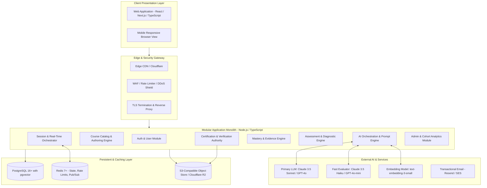
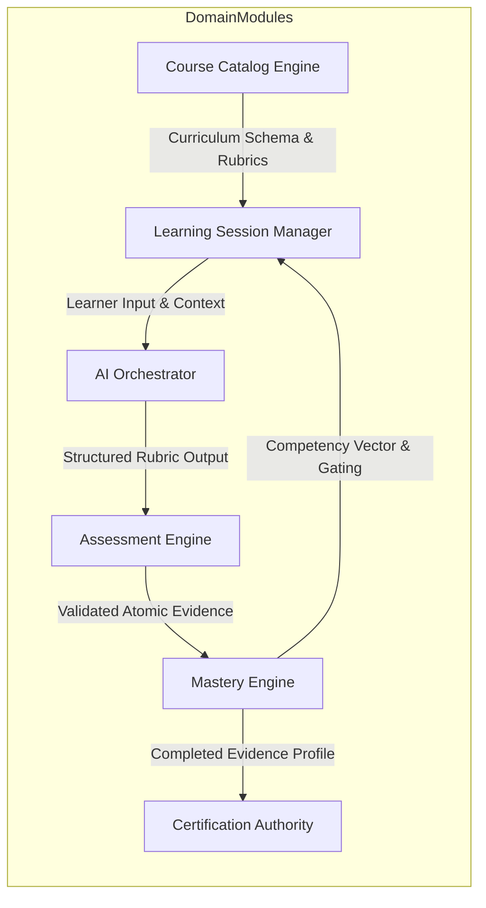

# System Architecture Specification

## 1. Architectural Philosophy & Principles
1. **Separation of Cognitive vs. Deterministic Authority**: The Large Language Model (LLM) is treated as an untrusted, probabilistic natural language processor. It interprets intent, teaches concepts, and scores open-ended responses against atomic rubrics. The **Mastery Engine** and **Certification Authority** are strictly deterministic software modules running verified mathematical and business logic.
2. **Modular Monolith First**: The system is organized as high-cohesion, low-coupling internal domain modules within a single deployable unit. This prevents distributed-system complexity (network latency, distributed transactions, partial failures) during early validation while strictly isolating domain boundaries for future microservices extraction.
3. **Modality-Agnostic Core Pipeline**: The core learning orchestration engine accepts normalized user intents and outputs structured pedagogical actions. Text chat, code editor interactions, and future voice streams interface through the exact same conversational session protocol.
4. **Auditability by Design**: Every prompt version, LLM response, evaluation rubric score, and evidence update is persistently logged with cryptographic trace IDs, ensuring complete replayability and educational defensibility.

---

## 2. High-Level Architecture Diagram

---

## 3. Core Domain Modules & Boundaries

### Module Responsibilities

| Module | Core Responsibility | Persistence & Boundary |
| :--- | :--- | :--- |
| **Auth & User** | User identity, authentication, session tokens, RBAC roles (Student, Instructor, Admin). | `users`, `user_roles`, `sessions` |
| **Course Catalog Engine** | Hierarchical curriculum definitions, learning objectives, atomic concepts, question banks, rubrics, versioning. | `courses`, `modules`, `chapters`, `concepts`, `learning_objectives`, `rubrics`, `questions` |
| **Session & Real-Time Manager** | Active conversation state, SSE stream orchestration, short-term context assembly, connection lifecycle. | Redis Active Sessions, `learning_sessions`, `chat_messages` |
| **AI Orchestrator** | RAG retrieval, prompt templating, model routing (Tutor vs. Evaluator), schema enforcement, fallbacks, token accounting. | Stateless orchestrator; logs to `ai_interactions`, OpenTelemetry/Langfuse |
| **Assessment Engine** | Diagnostic baseline testing, chapter checks, practical tasks, AI Viva/defense protocols, rubric scoring. | `assessment_attempts`, `assessment_answers`, `rubric_evaluations` |
| **Mastery Engine** | Bayesian Knowledge Tracing (BKT), evidence accumulation, adaptive difficulty adjustment (Easy/Med/Hard), chapter progression gating. | `learner_states`, `concept_mastery`, `mastery_evidences` |
| **Certification Authority** | Deterministic credential evaluation, cryptographic signing, certificate PDF rendering, public verification endpoints. | `certificates`, `credential_records`, `certificate_revocations` |
| **Admin & Analytics** | Course authoring workbench, prompt regression test runners, cohort drop-off metrics, integrity audits. | Read models & analytics aggregates |

---

## 4. Communication & Interaction Patterns
* **Client-to-Server**:
  * **Standard REST/JSON**: Authentication, catalog browsing, course enrollment, user profile, administrative CRUD.
  * **HTTP POST + Server-Sent Events (SSE)**: Chat input and streaming AI responses. Allows immediate, real-time chunk streaming with lightweight reconnection protocols over HTTP/2.
* **Internal Module Communication**: Synchronous in-memory interfaces using strictly typed TypeScript contracts. Events (e.g., `ConceptEvidenceRecorded`, `ChapterCompleted`, `CourseMasteryAchieved`) are broadcast via an in-process typed EventEmitter or Redis Pub/Sub for decoupling.
* **Server-to-Database**: Connection-pooled PostgreSQL queries using Prisma ORM or Kysely for type-safe query generation and migration safety.
* **Server-to-LLM**: Streaming HTTP client connections with automated exponential backoff, jitter, timeout management, and circuit-breaker failover.
