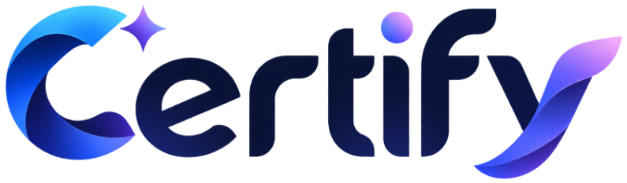
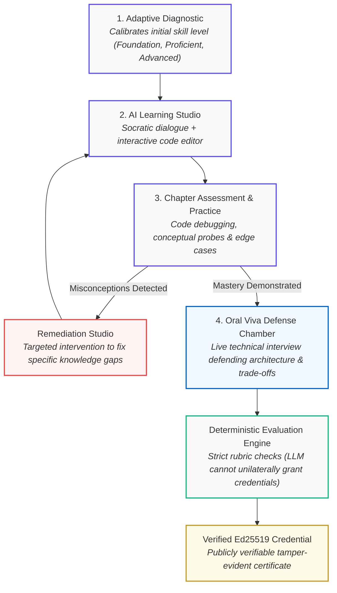
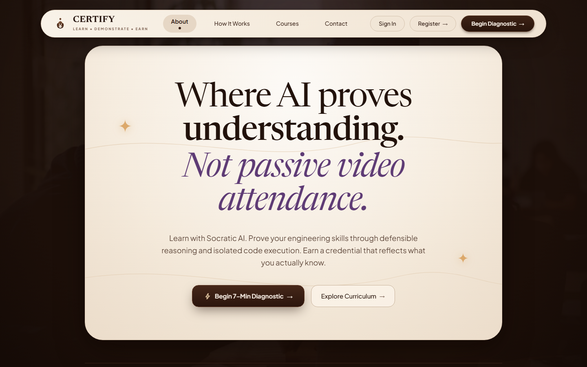
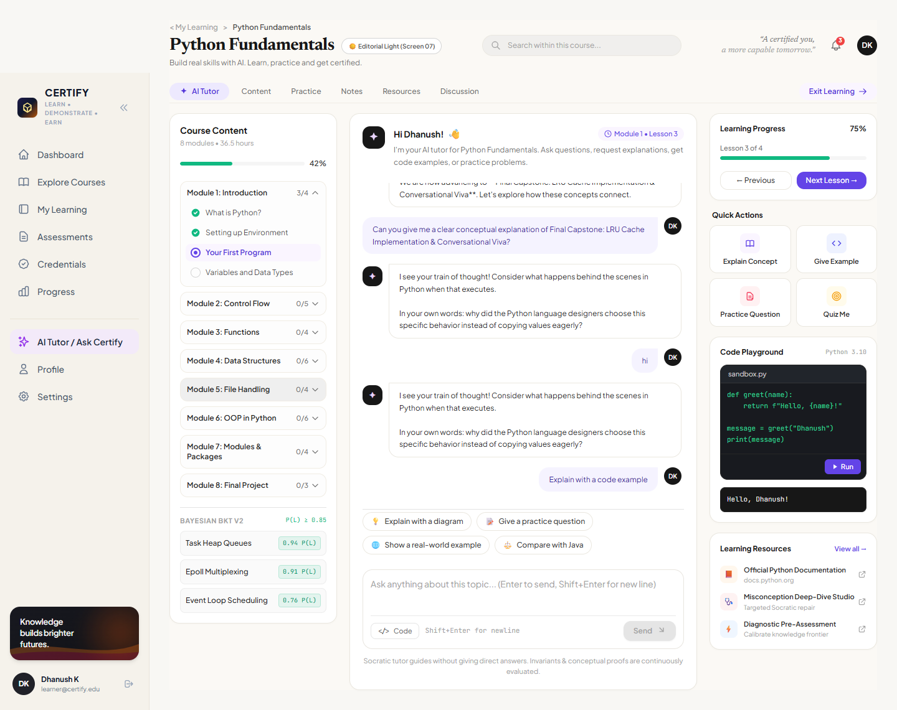
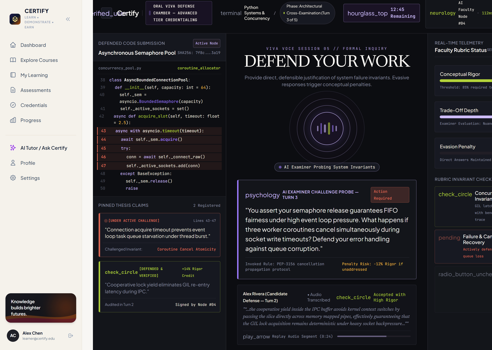
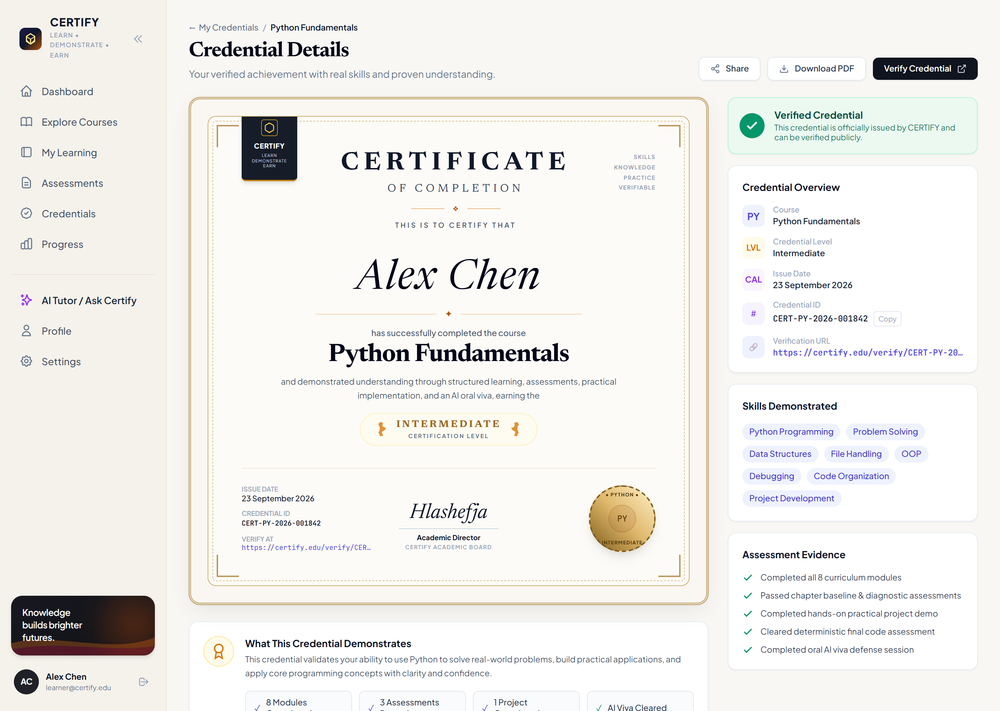
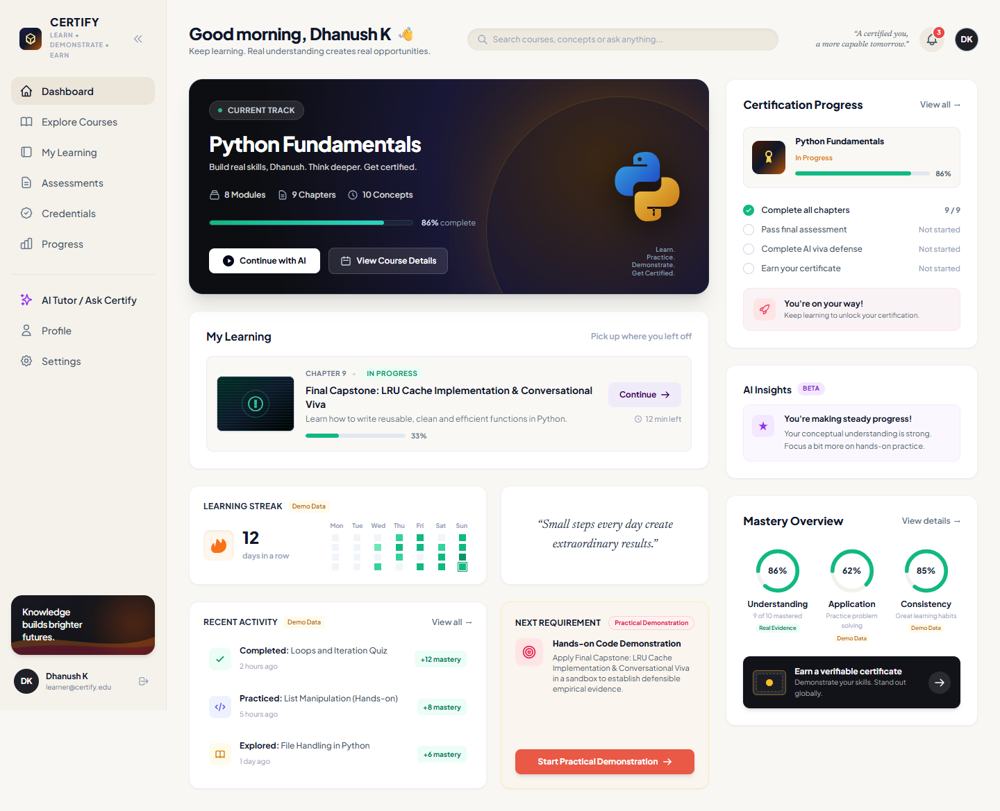
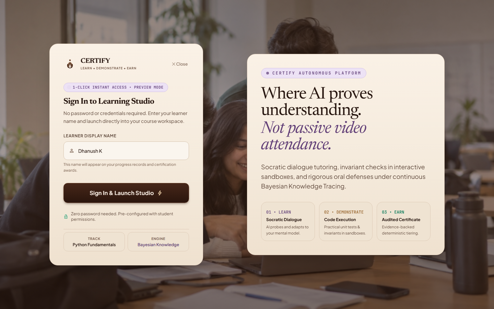

<div align="center">

  

  # CERTIFY

  **AI-First Interactive Engineering Qualification & Credentialing Platform**

  *Credentials earned through demonstrated, defensible understanding — never passive video completion.*

  <br />

  [](https://www.typescriptlang.org/)
  [](https://react.dev/)
  [](https://vitejs.dev/)
  [](https://hono.dev/)
  [](https://workers.cloudflare.com/)
  [](https://www.prisma.io/)
  [](https://neon.tech/)
  [](https://ed25519.cr.yp.to/)
  [](https://github.com/oframe/ogl)
  [](https://vitest.dev/)
  [](LICENSE)

</div>

---

## 📖 Table of Contents

- [The Problem: Why Online Certificates Are Broken](#-the-problem-why-online-certificates-are-broken)
- [The Solution: How Certify Fixes It](#-the-solution-how-certify-fixes-it)
- [How Certify Works (The 4-Step Learner Journey)](#-how-certify-works-the-4-step-learner-journey)
- [Key Features Explained Simply](#-key-features-explained-simply)
- [Visual Interface Tour](#-visual-interface-tour)
- [System Architecture](#-system-architecture)
- [Technology Stack](#-technology-stack)
- [Repository Structure](#-repository-structure)
- [Quickstart Guide (Get Running in 2 Minutes)](#-quickstart-guide-get-running-in-2-minutes)
  - [Prerequisites](#prerequisites)
  - [1. Backend Setup](#1-backend-setup)
  - [2. Frontend Setup](#2-frontend-setup)
  - [Default Test Credentials](#default-test-credentials)
- [Testing & Quality Assurance](#-testing--quality-assurance)
- [Design System & Aesthetics](#-design-system--aesthetics)
- [In-Depth Documentation](#-in-depth-documentation)
- [License](#-license)

---

## ❌ The Problem: Why Online Certificates Are Broken

Today, millions of students and engineers take online courses, yet tech companies and universities routinely ignore course certificates on resumes. Why?

Because the modern online learning model is plagued by **three fatal flaws**:

1. **Passive Consumption ("Watch to Complete")**  
   Most platforms award completion if a video simply finishes playing. Learners can mute the tab, let it run in the background, and receive a certificate without absorbing a single concept.

2. **Easily Gamed Multiple-Choice Questions (MCQs)**  
   Assessments rely on static 4-choice questions. Learners can guess until they pass, Google the exact questions, or paste them into an AI to get instant answers in seconds.

3. **Zero Proof of Real Understanding**  
   A traditional PDF certificate displays a name and a logo, but offers **zero evidence** of what the learner actually understands. It cannot tell an employer whether the person can debug real code, make engineering trade-offs, or defend technical decisions under scrutiny.

> **Result:** Certificates have become meaningless participation trophies. Learners waste time on superficial learning, and employers have no reliable signal of competence.

---

## 💡 The Solution: How Certify Fixes It

**Certify fundamentally reverses this dynamic:**

> ### *"You only earn a credential when you can actively explain, build, and defend your understanding."*

Certify combines an **interactive Socratic AI mentor**, **hands-on code execution**, an **oral viva defense chamber**, and **cryptographic verification**:

* 🧠 **No Spoon-Fed Answers**: Instead of just lecturing or generating code for you, the AI acts as a patient mentor that uses Socratic dialogue to lead you to the "aha!" moment yourself.
* 🛠️ **Real Hands-On Debugging**: You write, run, and fix real code directly in the browser.
* 🎙️ **The Oral Viva Defense Chamber**: To graduate, you must defend your architectural decisions in a conversational interview with the AI. You are asked *why* you chose a specific data structure, what trade-offs exist (speed vs. memory), and how your system behaves when things break.
* 🔒 **Deterministic & Tamper-Evident Credentials**: The AI cannot hand out certificates arbitrarily. Hard deterministic scoring rules evaluate your performance, and certificates are cryptographically signed using **Ed25519 digital signatures** that anyone (employers, recruiters, professors) can instantly verify online.

---

## 🔄 How Certify Works (The 4-Step Learner Journey)



### The 4 Main Stages Explained:

1. **Diagnostic Pre-Assessment**  
   Before diving into a track, a brief diagnostic calibrates your existing knowledge. You aren't forced to repeat what you already know; the system adapts to your current level.

2. **The Socratic AI Learning Studio**  
   You learn by doing. A dual-pane workspace pairs a live code editor with a Socratic conversational mentor. If you make a mistake, the AI doesn't just hand you the solution—it points out contradictory assumptions or asks guiding questions until you discover the fix.

3. **Active Remediation**  
   If the system detects persistent misconceptions (e.g., confusing variable scope, recursion base cases, or reference vs. value semantics), you are smoothly routed into a **Remediation Studio** designed to resolve that exact blind spot.

4. **Oral Viva Defense & Credential Issuance**  
   Once practical milestones are reached, you enter the Viva Chamber. You answer probing questions about your project: *“What is the time complexity of your lookup? How would this perform under 10,000 concurrent requests? What if network calls fail?”* Once you successfully defend your work, a cryptographically signed credential is generated and entered into the public verification ledger.

---

## ⚡ Key Features Explained Simply

| Feature | What It Is | Why It Matters |
| :--- | :--- | :--- |
| **Socratic AI Tutor** | An AI mentor powered by Claude (`claude-sonnet-4-6`) bounded by rigorous educational rubrics. | Encourages true problem-solving and critical thinking rather than copy-pasting answers. |
| **Bayesian Knowledge Tracing (BKT)** | A mathematical model estimating the probability that a learner actually understands a concept ($P(L_t)$). | Accounts for lucky guesses and accidental slips, giving a realistic mastery score across every skill. |
| **Oral Viva Defense** | A simulated technical oral exam modeled after academic defenses and senior engineering interviews. | Proves that you understand *why* your code works, not just that it runs. |
| **Deterministic Grading Engine** | Strict mathematical rule engine that separates AI conversation from credential approval. | Guarantees that AI hallucinations or prompt injections can never trick the system into granting a certificate. |
| **Ed25519 Cryptographic Signatures** | Public-key digital signatures issued with unique Key IDs (`kid`) and historical key rotation support. | Every certificate is tamper-evident. Changing even one letter of a name or grade invalidates the signature. |
| **Privacy-Preserving Public Ledger** | Public URL (`/verify/:id`) where anyone can inspect verified competencies and dates. | Proves your accomplishment to recruiters and universities without exposing private chat logs or sensitive personal info. |
| **Editorial & Sensory UI** | Dynamic WebGL GPU silk shader, tactile typography, 60fps smooth scrolling, and spring physics. | Provides a high-end, inspiring workspace that makes learning feel serious, elegant, and engaging. |

---

## 🖼️ Visual Interface Tour

| Screen | Preview | Description |
| :--- | :---: | :--- |
| **Editorial Landing Experience** |  | Warm ivory aesthetic with fluid WebGL silk backdrop, philosophy manifesto, and curriculum overview. |
| **AI Learning Studio** |  | High-focus dual-pane workspace pairing the Socratic conversational mentor with a live code editor. |
| **Oral Viva Defense Chamber** |  | Conversational examination chamber probing code rationale, architectural trade-offs, and failure recovery. |
| **Tamper-Evident Credential** |  | Gold-filigree certificate display with competency radar, verified syllabus breakdown, and signature hash. |
| **Learner Mastery Dashboard** |  | Real-time telemetry tracking active tracks, Bayesian skill probabilities, and upcoming milestones. |
| **Secure Authentication Portal** |  | Minimalist card design featuring an interactive reactive particle dither shader. |

*Full screenshot archive available in [`docs/screenshots/SCREENSHOT_INDEX.md`](docs/screenshots/SCREENSHOT_INDEX.md).*

---

## 🏗️ System Architecture

Certify is built with a modern edge-ready architecture, combining a blazing-fast **React 19** frontend with an ultra-lightweight **Hono** backend deployable to **Cloudflare Workers** or standard **Node.js**:

```
 ┌─────────────────────────────────────────────────────────────────────────────┐
 │                             FRONTEND CLIENT                                 │
 │     React 19 • Vite • OGL WebGL Shaders • Motion (Framer) • Lenis Scroll    │
 └──────────────────────────────────────┬──────────────────────────────────────┘
                                        │ HTTPS / JSON API
                                        ▼
 ┌─────────────────────────────────────────────────────────────────────────────┐
 │                       BACKEND API (HONO FRAMEWORK)                          │
 │         Cloudflare Workers Edge Runtime / Node.js 22 LTS Local Server       │
 ├─────────────────────┬───────────────────────┬───────────────────────────────┤
 │  Better Auth Auth   │ Course Catalog Engine │  AI Socratic Tutor (Claude)   │
 ├─────────────────────┼───────────────────────┼───────────────────────────────┤
 │ BKT Mastery Engine  │ Chapter Assessments   │ Oral Viva Defense Engine      │
 ├─────────────────────┼───────────────────────┼───────────────────────────────┤
 │ Ed25519 Signing     │ Resend Notifications  │ Cloudflare R2 Artifact Vault  │
 └─────────────────────┴───────────┬───────────┴───────────────────────────────┘
                                   │
                                   ▼
 ┌─────────────────────────────────────────────────────────────────────────────┐
 │                             DATA PERSISTENCE                                │
 │       Prisma 5.22 ORM • Neon Serverless PostgreSQL (Production)             │
 │                         SQLite (Fast Local Dev & Testing)                   │
 └─────────────────────────────────────────────────────────────────────────────┘
```

### Core Architecture Highlights:
* **Edge & Web Standards**: Built using standard Web APIs (`fetch`, `Request`, `Response`, `crypto.subtle`). Runs with zero cold starts on Cloudflare Workers and seamlessly in Node.js 22 LTS during local development.
* **Deterministic Isolation**: Cognitive LLM workflows are strictly sandboxed. The AI produces structured scores against rubrics, but only deterministic application code can update learner state or issue credentials.
* **Session Security**: Sessions are authoritative in the database via **Better Auth**, stored in secure, HttpOnly, SameSite cookies with automatic CSRF origin verification on mutations.
* **Two-Tier Rate Limiting**: Coarse edge protection via Cloudflare rate limiting combined with coordinated stateful quotas (Cloudflare Durable Objects) on expensive AI and certificate endpoints.

---

## 🛠️ Technology Stack

### 🖥️ Frontend
* **Core**: [React 19](https://react.dev/), [TypeScript 5.6+](https://www.typescriptlang.org/), [Vite 8](https://vitejs.dev/)
* **Graphics & Shaders**: [OGL](https://github.com/oframe/ogl) (Fluid WebGL silk canvas), [Three.js](https://threejs.org/)
* **Animations**: [Motion](https://motion.dev/) (Framer Motion) & [Lenis](https://lenis.darkroom.engineering/) (Smooth 60fps inertia scrolling)
* **Icons & Feedback**: [Lucide React](https://lucide.dev/), [Canvas Confetti](https://github.com/catdad/canvas-confetti)
* **Code Inspection**: [Oxlint](https://oxc.rs/) for blazing-fast static linting

### ⚙️ Backend & Edge
* **Server Framework**: [Hono 4.13](https://hono.dev/) (Runs anywhere: Cloudflare Workers, Node.js, Bun, Deno)
* **Runtimes**: [Cloudflare Workers](https://workers.cloudflare.com/) (Edge Production) & [Node.js 22 LTS](https://nodejs.org/) (`@hono/node-server`)
* **ORM & Database**: [Prisma 5.22](https://www.prisma.io/) with Neon Serverless driver adapter (`@prisma/adapter-neon`) + [PostgreSQL](https://neon.tech/) / [SQLite](https://sqlite.org/)
* **Authentication**: [Better Auth](https://www.better-auth.com/) sole session authority in database with HttpOnly cookies & CSRF protection
* **AI Provider**: [Anthropic Claude](https://www.anthropic.com/) (Tutor: `claude-sonnet-4-6`, Evaluator: `claude-haiku-4-5-20251001`)
* **Cryptography**: RFC 8032 Ed25519 asymmetric keypairs (`crypto.subtle` / `@noble/ed25519`) with Key ID rotation registry
* **Email & Storage**: [Resend](https://resend.com/) for notifications, [Cloudflare R2](https://www.cloudflare.com/developer-platform/products/r2/) for object storage
* **Validation & Testing**: [Zod](https://zod.dev/) 3.23, [Vitest](https://vitest.dev/) 2.1

---

## 📂 Repository Structure

```
certify/
├── backend/                        # Hono API Backend (Cloudflare Workers & Node.js)
│   ├── prisma/
│   │   ├── schema.prisma           # SQLite schema for instant zero-dependency local dev
│   │   ├── schema.postgresql.prisma # PostgreSQL schema for Neon production deployment
│   │   └── seed.ts                 # Database seeding with flagship Python track & accounts
│   ├── src/
│   │   ├── config/                 # Environment variables & model configuration
│   │   ├── modules/
│   │   │   ├── ai/                 # Socratic prompting, rubric evaluation & guardrails
│   │   │   ├── assessment/         # Chapter assessments, rubrics & Viva defense
│   │   │   ├── auth/               # User registration, login & Better Auth sessions
│   │   │   ├── certificates/       # Ed25519 signing, key rotation & public verification
│   │   │   ├── courses/            # Course tracks, chapters, syllabus management
│   │   │   ├── email/              # Resend email templates & delivery logs
│   │   │   ├── mastery/            # Bayesian Knowledge Tracing (BKT) engine
│   │   │   ├── sandbox/            # Isolated execution gatekeeper (HTTP 503 fail-closed)
│   │   │   ├── sessions/           # AI learning studio chat sessions & history
│   │   │   └── storage/            # Cloudflare R2 asset storage & signed URLs
│   │   ├── shared/                 # Middleware (auth, rate limiting, error handler, prisma)
│   │   ├── app.ts                  # Core Hono application configuration
│   │   ├── server.ts               # Local Node.js server runner (port 5000)
│   │   └── worker.ts               # Cloudflare Worker entrypoint with Durable Objects
│   ├── wrangler.toml               # Cloudflare Workers configuration
│   └── package.json
│
├── frontend/                       # React 19 + Vite User Interface
│   ├── public/                     # Static assets, branding, and icons
│   ├── src/
│   │   ├── components/             # High-fidelity UI views
│   │   │   ├── ai/                 # Socratic chat mentor & prompt inputs
│   │   │   ├── credentials/        # Certificate viewer & gold filigree renderer
│   │   │   ├── landing/            # Editorial landing sections (WebGL Silk, Bento, Steps)
│   │   │   ├── mastery/            # Radar charts & Bayesian knowledge telemetry
│   │   │   ├── AuthView.tsx        # Dither canvas authentication portal
│   │   │   ├── CatalogView.tsx     # Course catalog directory
│   │   │   ├── CourseDetailsView.tsx # Syllabus & competency prerequisites
│   │   │   ├── DashboardView.tsx   # Learner home hub & metric summaries
│   │   │   ├── LearningStudio.tsx  # Interactive AI tutor & live code editor
│   │   │   ├── VivaChamberView.tsx # Oral Viva examination chamber
│   │   │   └── ...                 # Diagnostic, Remediation, Results & Verify views
│   │   ├── motion/                 # Lenis smooth scroll & easing curves
│   │   ├── services/api.ts         # Type-safe backend API client
│   │   ├── index.css               # Editorial CSS design tokens & typography
│   │   └── App.tsx                 # View state router & application layout
│   └── package.json
│
├── docs/                           # Architectural blueprints & engineering specifications
│   ├── SYSTEM_ARCHITECTURE.md      # Full architecture blueprint & sequence diagrams
│   ├── PRODUCT_SCOPE.md            # Product thesis & scope boundaries
│   ├── ASSESSMENT_ENGINE.md        # Viva protocol, rubrics & diagnostic design
│   ├── CERTIFICATION_ENGINE.md     # Ed25519 signing & verification specifications
│   ├── MASTERY_ENGINE.md           # Bayesian Knowledge Tracing formulas
│   └── screenshots/                # 30+ visual screenshots across all screens
│
├── DESIGN.md                       # Canonical design system source of truth
└── README.md                       # This document
```

---

## 🚀 Quickstart Guide (Get Running in 2 Minutes)

You can run the entire platform locally with zero external cloud dependencies. Local development defaults to a self-contained SQLite database.

### Prerequisites
* **Node.js**: Version `20.x` or `22.x LTS` (Node 18+ supported)
* **npm**: Version `9.x` or `10.x`
* **Git**

---

### 1. Backend Setup

Open a terminal and navigate to the backend:

```bash
cd backend
npm install
```

Initialize your local database and seed it with courses and test accounts:

```bash
# Push schema to local SQLite database
npm run db:push

# Generate the Prisma client
npm run db:generate

# Seed the database with the flagship Python track and demo users
npm run db:seed
```

Start the backend development server:

```bash
npm run dev
```

The backend will start immediately at **`http://localhost:5000`**.  
Verify it is running by checking the health endpoint: `http://localhost:5000/api/v1/health`

---

### 2. Frontend Setup

Open a second terminal window and navigate to the frontend:

```bash
cd frontend
npm install
```

Start the Vite development server:

```bash
npm run dev
```

Open **`http://localhost:5173`** in your browser. You can now explore the full Certify application!

---

### 🔑 Default Test Credentials

The database seed provides two pre-configured accounts:

| Role | Email | Password | What You Can Explore |
| :--- | :--- | :--- | :--- |
| **Learner** | `learner@certify.edu` | `Password123!` | Enrolled in *Python Fundamentals*, active BKT history, learning studio, and viva defense |
| **Instructor** | `instructor@certify.edu` | `Password123!` | Course catalog overview & assessment inspection |

*Want to start completely fresh? You can also click **"Get Started"** on the landing page and register a brand new learner account.*

---

## 🧪 Testing & Quality Assurance

Certify is built with a comprehensive automated test suite covering unit logic, cryptographic signatures, rate limiting, and Better Auth session security:

```bash
# Run the complete backend test suite (44+ tests across 11 test files)
cd backend
npm test

# Verify TypeScript compilation with zero errors
npx tsc --noEmit

# Run Cloudflare Worker bundle verification (dry run)
npx wrangler deploy --dry-run
```

```bash
# Run Oxlint static analysis on the frontend
cd ../frontend
npm run lint

# Build production bundle for the frontend
npm run build
```

---

## 🎨 Design System & Aesthetics

Certify's visual identity balances academic rigor with cutting-edge digital craftsmanship:

* **Editorial Color Palette**: Warm ivory backgrounds (`#F8F7F4`), elevated white cards, deep obsidian text (`#0F1117`), and gold filigree accents (`#C59B27`) on credentials.
* **GPU-Accelerated Shaders**: A custom WebGL silk ribbon canvas powered by OGL creates subtle, ambient depth without distracting from deep learning.
* **Academic Typography**: High-contrast serifs for chapter headings paired with clean grotesques for readability and monospace fonts (`JetBrains Mono`) for code telemetry.
* **Tactile Interactions**: Inertial smooth scrolling via Lenis, spring physics on modal transitions, and interactive particle dithering.

For complete token definitions and CSS variable specifications, see [`DESIGN.md`](DESIGN.md).

---

## 📚 In-Depth Documentation

Explore the comprehensive engineering documentation in [`docs/`](docs/):

* 🏛️ [System Architecture Blueprint](docs/SYSTEM_ARCHITECTURE.md) — Comprehensive service topology, edge deployment, and sequence flows.
* 🎯 [Product Scope & Thesis](docs/PRODUCT_SCOPE.md) — The founding principles and scope boundaries of Certify.
* 📝 [Assessment & Viva Engine](docs/ASSESSMENT_ENGINE.md) — Scoring rubrics, diagnostic protocols, and oral viva questioning methodology.
* 🎓 [Certification & Cryptography Engine](docs/CERTIFICATION_ENGINE.md) — Ed25519 asymmetric cryptography, key rotation, and privacy-preserving public verification.
* 📈 [Mastery Engine & BKT](docs/MASTERY_ENGINE.md) — Mathematical formulas and parameters behind Bayesian Knowledge Tracing.
* 📸 [Screenshot Directory](docs/screenshots/SCREENSHOT_INDEX.md) — High-resolution screenshot gallery for every view state.

---

## 📄 License

This project is licensed under the [ISC License](LICENSE).

<br />

<div align="center">
  <sub>Built with precision for authentic, defensible engineering education.</sub>
</div>
