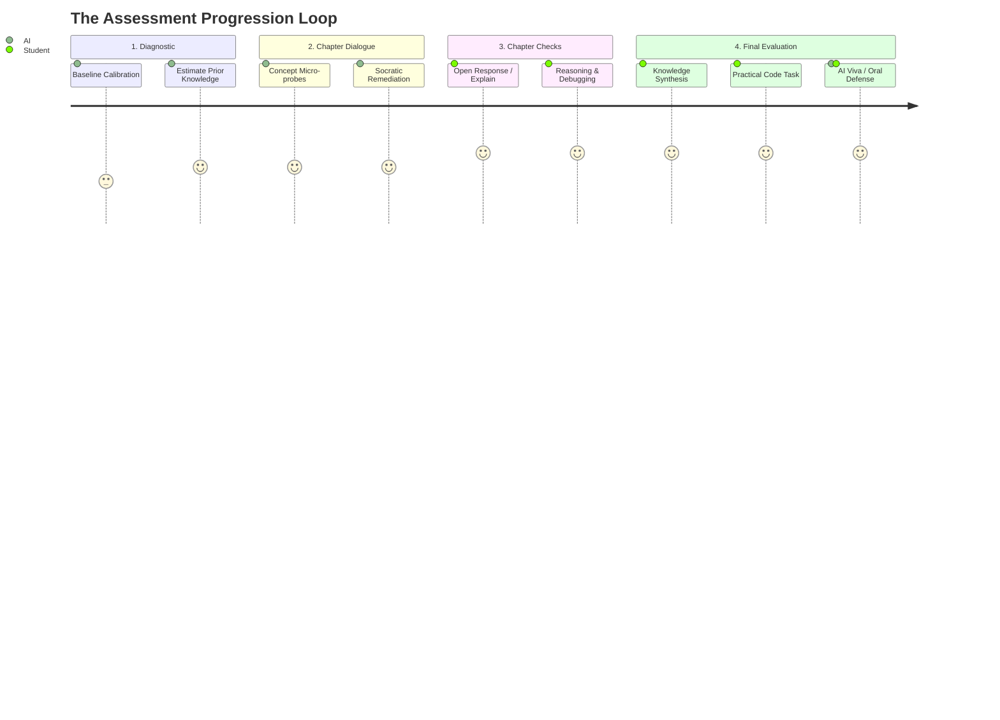

# Assessment & Evaluation Engine Specification

## 1. Assessment Philosophy & Stages

Assessment in Certify is integrated throughout the learning journey rather than relegated to an easily gamed end-of-course test:



---

## 2. The Baseline Diagnostic Engine

* **Objective**: Estimate baseline knowledge ($P(L_0)$) and select initial starting difficulty without discouraging the learner.
* **Mechanism**: 3 to 5 adaptive questions.
  1. *Question 1 (Foundational)*: Tests core terminology and basic intuition.
  2. *Branching Logic*:
     * If answered with strong conceptual depth $\rightarrow$ Question 2 probes nuance/mechanics.
     * If answered with partial understanding $\rightarrow$ Question 2 stays at baseline to verify foundation.
     * If answered incorrectly $\rightarrow$ Diagnostic concludes cleanly, assigning `Foundation (Easy)` starting track with zero penalty.
* **Outcome**: Sets initial concept prior vector $P(L_0) \in \{0.15, 0.45, 0.75\}$.

---

## 3. Chapter Assessment Protocol

When a chapter's instructional phase finishes, the AI explicitly transitions state:
> *"We've covered the fundamentals of functions and closures. Now let's see what you can do on your own without me giving hints. I'll ask you four focused questions to verify your understanding."*

### Structure of a Chapter Assessment (4 Questions)
1. **Explain in Own Words**: "In your own words, explain why a closure retains access to variables even after the outer function has finished executing."
2. **Predict / Reason**: "Look at this snippet. Will this throw an error or print a value? Explain why."
3. **Application / Practical**: "Write a function `make_counter()` that demonstrates closure state encapsulation."
4. **Edge Case / Trade-off**: "What memory risks can occur if a closure inadvertently captures large data objects?"

---

## 4. Final Evaluation: Practical Task & AI Viva / Defense

For all courses, the final milestone goes beyond written questions to test synthesis, practical execution, and architectural reasoning:

### Component A: Knowledge Synthesis (Adaptive Checkpoint)
8-10 cross-chapter questions testing synthesis across disparate concepts (e.g., combining data structures with exception handling and generator streaming).

### Component B: Practical Task
A focused, realistic implementation task (e.g., implementing an in-memory LRU cache or stream processing log analyzer).

### Component C: The AI Viva / Oral Defense
The AI inspects the learner's submitted practical solution and conducts a **3-turn follow-up defense interrogation**:
```
AI: "I noticed in your solution that you utilized a dictionary for key lookups alongside a doubly-linked list. Why was this combination selected over a simple list or OrderedDict?"
Learner: "The dictionary provides O(1) key access, while the doubly-linked list allows O(1) removal and re-insertion at the head for recency tracking."
AI (Follow-up Probe): "Excellent. Now consider an environment where memory is severely constrained. What overhead does each node in the doubly-linked list introduce, and how could you optimize it?"
```
This multi-turn defense renders pasted LLM code useless: **the learner must understand every line and design trade-off to pass.**
