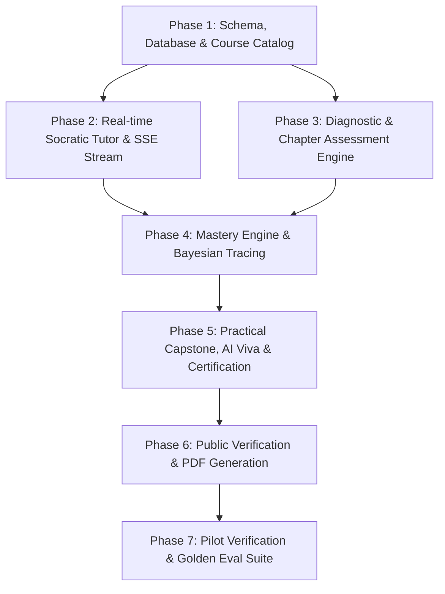

# End-to-End Implementation & Build Plan

## 1. Architectural Build Sequence & Dependency Graph

Building components in the correct order prevents refactoring deadlocks. The core deterministic engine and schema must precede the AI integration:

---

## 2. Phase-by-Phase Implementation Blueprint

### Phase 1: Database Foundation, Auth & Course Catalog
* **Database Work**: Initialize PostgreSQL 16 with `pgvector`. Configure Prisma ORM with the complete relational schema. Seed flagship course: **"Python Fundamentals"** (8 chapters, 24 concepts, rubrics, and question banks).
* **Backend Work**: User registration, login, JWT token issuance, refresh cookies, course catalog REST endpoints (`GET /courses`, `GET /courses/:slug`, `POST /courses/:slug/enroll`).
* **Frontend Work**: Modern React + Vite + Tailwind/Vanilla CSS SPA. Course discovery catalog, course syllabus breakdown, user authentication screens.
* **Exit Criteria**: A user can register, log in, browse the Python Fundamentals course, inspect syllabus chapters, and enroll.

---

### Phase 2: Socratic AI Tutor & Real-Time SSE Chat
* **Backend Work**: Learning session manager, Redis working memory buffer, pgvector RAG retrieval for chapter teaching content, Anthropic/OpenAI streaming adapter, SSE endpoint (`POST /sessions/:id/messages` returning `text/event-stream`).
* **AI Work**: Socratic Tutor prompt v1.0, sliding window context assembler, instruction inversion guardrails.
* **Frontend Work**: Conversational learning interface: split-screen layout (course navigation on left, live streaming AI chat in center, real-time progress indicators on right).
* **Exit Criteria**: A learner can converse with the AI tutor about Chapter 1 concepts, receiving streaming markdown explanations, code snippets, and guided questions.

---

### Phase 3: Diagnostic & Assessment Engine
* **Backend Work**: Baseline diagnostic endpoints, chapter check retrieval and submission handlers, background evaluation queue.
* **AI Work**: Fast Rubric Evaluator (Claude 3.5 Haiku) with strict `Zod` JSON schema output. Question bank prompts for "Explain in own words", "Reason/Why", and "Debugging".
* **Frontend Work**: Diagnostic intake modal, interactive chapter assessment card with auto-transition from tutor mode to assessment mode.
* **Exit Criteria**: At the end of a chapter, the tutor transitions to assessment mode, asks 4 varied questions, and the evaluator scores the answers against atomic rubric criteria in JSON.

---

### Phase 4: Mastery Engine & Bayesian Knowledge Tracing
* **Backend Work**: Implement `BayesianKnowledgeTracer` mathematical model. Persist `concept_mastery` and `mastery_evidences`. Chapter progression gatekeeper (unlocks next chapter only if $P(\text{Mastery}) \ge 0.75$).
* **AI Work**: Targeted Remediation Specialist agent activated when an assessment check fails.
* **Frontend Work**: Live mastery badge, concept difficulty indicators (`Easy` / `Medium` / `Hard`), and remediation prompts.
* **Exit Criteria**: Answering correctly increases concept mastery probability; answering incorrectly triggers remediation and locks the next chapter until mastery is demonstrated.

---

### Phase 5: Practical Capstone, AI Viva & Deterministic Certification
* **Backend Work**: Practical task runner sandbox (AST checks and isolated unit tests). Deterministic Certification Authority: formula aggregating chapter mastery, practical score, viva defense, and consistency.
* **AI Work**: AI Viva Defense Agent: 3-turn oral defense challenging the student's architectural choices and trade-offs.
* **Frontend Work**: Code submission interface for capstone task + interactive multi-turn Viva dialogue screen.
* **Exit Criteria**: Student submits code $\rightarrow$ passes tests $\rightarrow$ defends architectural trade-offs in Viva $\rightarrow$ Certification Engine computes composite evidence and issues tiered credential.

---

### Phase 6: Public Verification & PDF Generation
* **Backend Work**: Ed25519 cryptographic signing of credential claims. Public verification endpoint `GET /verify/:credentialId`. Dynamic PDF certificate generation (Puppeteer / PDFKit).
* **Frontend Work**: Publicly accessible, responsive verification portal showing credential status, recipient, tier, and evidence summary (without private chats).
* **Exit Criteria**: Any external third party visiting `/verify/:credentialId` sees verified proof of demonstrated learning.

---

### Phase 7: Pilot Benchmarking & Golden Eval Suite
* **AI Work**: Run Golden Eval benchmark of 200+ answers to ensure Cohen's Kappa $\kappa \ge 0.85$.
* **Testing Work**: End-to-end Playwright tests covering the entire learner journey.
* **Pilot**: Run 20-50 real pilot learners through the Python Fundamentals course with human instructor spot-checks of certification decisions.
* **Exit Criteria**: Zero false-positive certificates issued; pilot students validate that the interactive tutor is significantly more engaging than passive video playlists.
