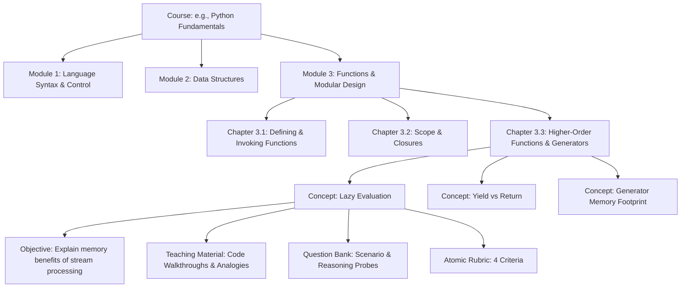

# Course Engine & Curriculum Domain Specification

## 1. Curriculum Hierarchy & Conceptual Model

A course in Certify is not a static video playlist or a linear document. It is a **Structured Competency Graph** comprising discrete learning units, atomic concepts, and measurable rubrics:



---

## 2. Core Curriculum Entities

### Course
* **ID & Slug**: Unique persistent identifiers (`uuid`, `python-fundamentals`).
* **Title, Summary & Description**: Public metadata for discovery.
* **Prerequisites**: Directed acyclic graph (DAG) of prerequisite course IDs or concept IDs.
* **Tier Thresholds**: Threshold criteria required for Foundation, Proficient, and Advanced certificates.
* **Status**: `DRAFT`, `REVIEW`, `PUBLISHED`, `ARCHIVED`.
* **SemVer**: Explicit version tracking (e.g., `v1.2.0`).

### Module & Chapter
* **Module**: Cohesive high-level pedagogical grouping (e.g., "Object-Oriented Programming").
* **Chapter**: The primary unit of learning and assessment. Chapters close the learning loop:
  1. *Introduce Concept* (AI Tutor)
  2. *Interactive Dialogue* (Learner questions & AI probes)
  3. *Understanding Check* (Micro-evaluation)
  4. *Remediation* (Targeted pivot if misunderstood)
  5. *Chapter Assessment* (Formal multi-question evaluation)
  6. *Advancement* (Unlocks next chapter once mastery threshold is met)

### Concept & Learning Objective
* **Concept**: Atomic knowledge unit (e.g., `closures`, `recursion`, `list_comprehension`).
* **Learning Objective**: Actionable Bloom's Taxonomy statement (e.g., "Evaluate the time-space tradeoff between recursion and iteration").

### Rubric & Atomic Criteria
Every concept has a formal evaluation rubric consisting of atomic, unambiguous criteria:
```json
{
  "conceptId": "concept_py_generators_001",
  "conceptName": "Python Generators and Lazy Evaluation",
  "rubricCriteria": [
    {
      "id": "crit_lazy_eval",
      "statement": "Articulates that values are computed on-demand rather than stored in memory upfront.",
      "weight": 0.35,
      "tierRequired": "EASY"
    },
    {
      "id": "crit_yield_vs_return",
      "statement": "Correctly contrasts yield (pauses execution state) with return (terminates frame).",
      "weight": 0.35,
      "tierRequired": "EASY"
    },
    {
      "id": "crit_memory_tradeoff",
      "statement": "Explains large-dataset scaling implications (O(1) memory vs O(N) memory).",
      "weight": 0.30,
      "tierRequired": "MEDIUM"
    }
  ]
}
```

---

## 3. Question Bank & Assessment Typologies

Certify strictly prohibits reliance on simple binary multiple-choice questions (MCQs). The question bank supports 8 question types designed to measure deep cognitive processing:

| Question Type | Cognitive Level | Example Prompt | Evaluation Mode |
| :--- | :--- | :--- | :--- |
| **Recall / Fundamentals** | Remember | "What keyword is used to pause a generator function and return a value?" | Fast match / Haiku |
| **Explain in Own Words** | Understand | "Explain the concept of variable shadowing as if teaching a junior developer." | Rubric Evaluator |
| **Compare & Contrast** | Analyze | "Compare a Python List with a Generator when processing a 10GB CSV file." | Rubric Evaluator |
| **Why / Reasoning** | Evaluate | "Why would you choose a Hash Set over a Sorted Array for membership checks?" | Rubric Evaluator |
| **Debugging / Flaw Identification**| Analyze | "This function produces an unexpected `UnboundLocalError`. Why?" | Rubric Evaluator |
| **Scenario / Transfer** | Apply | "Design a caching strategy for a weather app with 5-minute data staleness tolerance." | Rubric Evaluator |
| **Practical Task** | Create | "Write a Python generator function `stream_logs(filepath)` that yields ERROR lines." | AST / Unit Test + Evaluator |
| **AI Viva / Conversational Defense**| Higher-Order Defense | "You used a dictionary for frequency counts. What trade-offs emerge if memory is constrained?" | Viva Agent Multi-turn |

---

## 4. Course Versioning & Immutability Rules
* **Immutability of Active Cohorts**: Once a learner enrolls in a published course version (`v1.0.0`), their learning session, rubrics, and question mappings are pinned to `v1.0.0`.
* **SemVer Strategy**:
  * **Patch (`1.0.1`)**: Typo fixes, clarification in teaching text. Automatically applies to active learners.
  * **Minor (`1.1.0`)**: Added optional examples, new alternative questions in question bank. Safe to migrate.
  * **Major (`2.0.0`)**: Restructured chapters, altered rubric criteria, added/removed required competencies. Requires new enrollment; active learners complete their pinned version.
