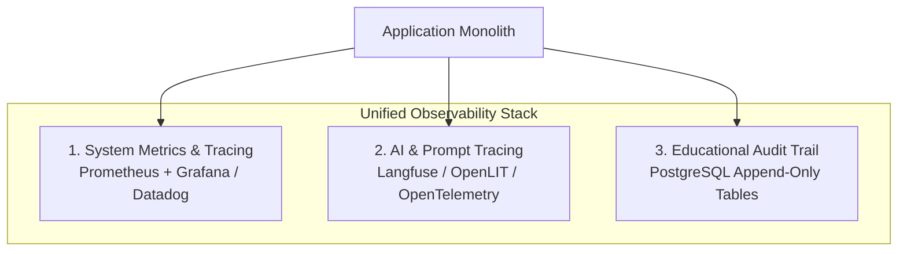

# Observability & Monitoring Specification

## 1. Observability Pillars

Production AI educational platforms require three distinct layers of observability:



---

## 2. LLM Tracing & Cost Accounting

Every interaction with an LLM is traced with structured metadata:
* **Trace Context**: `traceId`, `userId`, `sessionId`, `courseId`, `chapterId`.
* **Model Parameters**: `model` (e.g., `claude-3-5-sonnet-20241022`), `temperature`, `max_tokens`.
* **Latency Profile**: Time to First Token (TTFT), Total Stream Duration.
* **Token Ledger**: Exact input tokens, output tokens, cached tokens, and USD cost computed per call.
* **Rubric Evaluations**: Score results, rubric ID, and criterion-level determinations for auditability.

```typescript
export interface LLMCallTrace {
  traceId: string;
  sessionId: string;
  userId: string;
  agentRole: "TUTOR" | "EVALUATOR" | "VIVA" | "DIAGNOSTIC";
  model: string;
  promptTokens: number;
  completionTokens: number;
  totalCostUSD: number;
  ttftMs: number;
  durationMs: number;
  status: "SUCCESS" | "FALLBACK" | "ERROR";
  errorDetails?: string;
}
```

---

## 3. Core System & Educational Dashboards

### Dashboard 1: Platform & Operational Health
* **SSE Connection Health**: Active streaming connections, abrupt client disconnect rates.
* **API Latency**: p50, p95, p99 on `/api/v1/sessions/:id/messages`.
* **Cache Hit Rate**: Redis working memory hits vs cold-start PostgreSQL rehydrations.
* **PostgreSQL Performance**: Connection pool utilization, pgvector query latency ($< 30\text{ms}$).

### Dashboard 2: Educational & AI Integrity
* **Remediation Efficacy**: Ratio of students who successfully exit `NEEDS_REMEDIATION` status.
* **Tier Distribution**: Percentage of completions landing in `Foundation` vs `Proficient` vs `Advanced`.
* **Misconception Heatmap**: Concepts with highest recurring misconception flags across cohorts.
* **Cost Per Certified Learner**: Total LLM spend aggregated per issued certificate.
