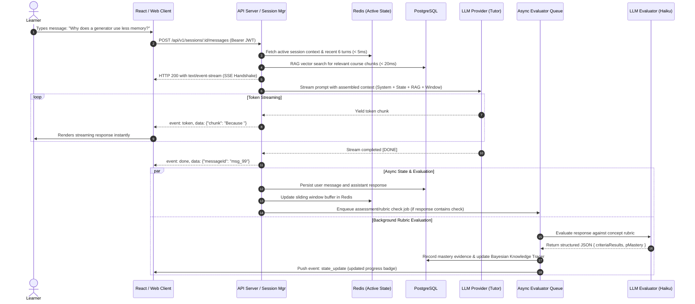

# Real-Time Interaction & Streaming Architecture

## 1. Real-Time Interaction Pipeline

The interactive tutoring dialogue must feel alive, conversational, and instant. A multi-second delay before the tutor starts speaking degrades engagement. Certify separates **real-time token streaming** from **asynchronous background evaluation**:

---

## 2. Protocol Selection: Server-Sent Events (SSE) vs. WebSockets

| Metric | Server-Sent Events (SSE) | WebSockets (WS) | Winner for Certify |
| :--- | :--- | :--- | :--- |
| **Transport & Overhead** | Standard HTTP/1.1 or HTTP/2 over port 443; lightweight. | Full duplex TCP upgrade; stateful connection maintenance. | **SSE** |
| **Reconnection Handling** | Built-in native browser reconnection with `Last-Event-ID`. | Requires complex custom heartbeat and reconnect logic. | **SSE** |
| **Load Balancing & Firewalls**| Zero corporate firewall/proxy issues; works behind standard AWS ALB/Cloudflare. | Often blocked by enterprise proxies; sticky session complexity. | **SSE** |
| **Modality Compatibility** | Ideal for unidirectional text token streams initiated by HTTP POST. | Necessary only for full-duplex audio/video streams (Voice). | **SSE for V1** (WS reserved for V2 Voice) |

---

## 3. Latency Budget & SLA Targets

To deliver a snappy, human-like dialogue experience, the system enforces strict latency targets:

| Milestone | Target SLA | Strategy |
| :--- | :--- | :--- |
| **Session Cache Retrieval** | $< 10\text{ms}$ | Redis hash lookup keyed by `session:{id}` |
| **Vector RAG Retrieval** | $< 25\text{ms}$ | pgvector HNSW index filtered by `course_id` and `chapter_id` |
| **Time to First Token (TTFT)** | $< 750\text{ms}$ | High-throughput LLM endpoints (Claude 3.5 Sonnet / GPT-4o) with streaming enabled |
| **Token Streaming Rate** | $> 40\text{ tokens/sec}$ | Native provider streaming |
| **Background Evaluation** | $< 2000\text{ms}$ | Asynchronous execution decoupled from user response stream |
